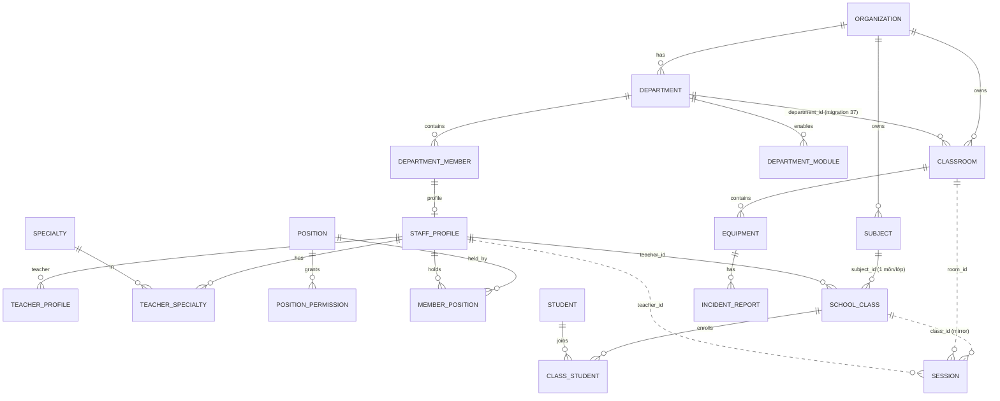

# MEMS — Phase 1–2: Hiện trạng source code (Stage 0)

Ngày khảo sát: 2026-11-20 · Nhánh `fixFlowCreateEmployee` · HEAD `cdd03b881e83902fae35dd440f9710bf26a6c749`
(khớp baseline trong yêu cầu) · Phạm vi: Subject, Class, Teacher, Department, Room, Schedule,
Identity/Authorization, migrations liên quan.

Phương pháp: chỉ đọc source. Mọi kết luận dưới đây bám vào file cụ thể trong repo; tài liệu
`docs/*.md` **không** được dùng làm bằng chứng chức năng đã triển khai (đúng quy tắc 11 của yêu cầu).
Không có file code nghiệp vụ nào bị sửa trong bước này — đây là tài liệu thiết kế/phân tích.

Quy ước phân loại:

- **Đã có** — code + schema đáp ứng được nhu cầu cơ bản.
- **Một phần** — có nhưng thiếu trường/rule/quyền hoặc lệch giữa schema thật và schema test.
- **Chưa có** — không tồn tại trong source (đã grep toàn repo).
- **Đề xuất** — ý kiến kỹ thuật, chưa phải quyết định nghiệp vụ.
- **Cần người dùng quyết định** — câu hỏi nghiệp vụ chưa có căn cứ trong code.

---

## 1. Tóm tắt điều hành

1. Hệ thống hiện có **quản lý môn học cơ bản** (CRUD + ngừng hoạt động), nhưng **một lớp chỉ gắn đúng một môn** qua `school_class.subject_id`; **không có** Curriculum/`class_subject`/học kỳ trong bất kỳ service nào.
2. Quan hệ giáo viên–môn học đang so khớp **theo tên không dấu** (`specialty.name_unaccented = subject.name_unaccented`), không có khóa ngoại — đổi tên môn/chuyên môn sẽ âm thầm phá kiểm tra.
3. Phòng học có `capacity`, `room_type`, `status` nhưng **API nội bộ không trả `room_type`**, không có yêu cầu thiết bị theo môn, không có lịch bảo trì/giờ hoạt động.
4. Lịch học hiện là CRUD buổi học với kiểm tra trùng giáo viên/lớp/phòng trong cùng tổ chức; **chưa có** năm học/học kỳ dạng bảng, phân bổ môn–buổi, thời lượng buổi, lịch rảnh giáo viên, ngày lễ, ca học, bản nháp/công bố/phê duyệt.
5. RBAC chạy theo catalog 55 mã quyền (module + scope), gán qua chức danh (`position_permission`, bundle, delegation); `subject.view/manage` là **ORGANIZATION-only** và **không có module guard** trong `SubjectController` (khác Student/Class).
6. Schema thật và schema test lệch nhau ở vài điểm quan trọng (`subject` unique code, `classroom.department_id` chỉ có ở migration 37, `session` chỉ có DDL trong test).
7. Dữ liệu cũ có rủi ro khi mở rộng: `subject_id` nullable, `class_student` unique một sinh viên–một lớp, `session.department_id` có thể NULL, mirror `class` trong Schedule giữ `subject` dạng text.
8. Các API có thể tái dùng cho Phase 2: `/internal/classes/{id}`, `/internal/rooms`, `/internal/rooms/{id}`, `/internal/orgs/{orgId}/modules`, `/internal/students/{studentId}/classes`.
9. Các API còn thiếu cho xếp lịch tự động: danh sách giáo viên theo phòng ban + trạng thái, chuyên môn theo ID, nhu cầu tiết/môn của lớp, phòng theo loại/sức chứa/thiết bị, năm học–học kỳ, lịch rảnh/bận, ngày lễ.
10. Toàn bộ test hiện xanh offline (Identity 78, People 319, Schedule 19, Facility 9, Gateway 3, FE 170) — nhưng test là H2 mô phỏng MySQL, không thay thế kiểm chứng DB thật.

---

## 2. Quản lý môn học (Subject)

### 2.1. Chức năng hiện có

| Chức năng | Trạng thái | Bằng chứng |
|---|---|---|
| Tạo môn | Đã có | `SubjectController.create` → `SubjectRepository.create` |
| Cập nhật môn | Đã có | `SubjectController.update` → `SubjectRepository.update` |
| Xem chi tiết | Đã có | `GET /subjects/{id}` → `SubjectRepository.require` |
| Danh sách | Đã có | `GET /subjects` → `SubjectRepository.list` |
| Tìm kiếm theo tên | Đã có | `SubjectRepository.list` dùng `name_unaccented LIKE ?` |
| Lọc theo trạng thái hoạt động | Một phần | Chỉ có cờ `includeInactive`; không lọc riêng "ngừng hoạt động" |
| Kích hoạt / ngừng hoạt động | Đã có | `PATCH /subjects/{id}/status` → `setActive` |
| Kiểm tra mã trùng | Một phần | Chỉ bắt `DuplicateKeyException`; migration 42 tạo **INDEX thường** `uq_subject_org_code`, không phải UNIQUE ⇒ DB thật cho phép trùng mã |
| Kiểm tra tên trùng | Đã có | UNIQUE `uq_subject_org_name(org_id,name_unaccented)` từ `DB_11_16.sql` |
| Phạm vi tổ chức | Đã có | Mọi truy vấn có `org_id=?` |
| Quyền quản lý | Đã có | `subject.manage` (tạo/sửa/đổi trạng thái), `subject.view` (đọc) |
| Xóa môn | Chưa có | Không có endpoint DELETE; cố ý dùng ngừng hoạt động + FK RESTRICT |
| Phân trang | Chưa có | Trả `List<SubjectResponse>` toàn bộ |
| Tìm theo mã môn | Chưa có | Chỉ tìm theo tên |
| Endpoint check-code | Chưa có | Không có `/subjects/check-code` |
| Module guard | Chưa có | `SubjectController` không gọi `OrganizationModuleGuard` (Student/Class có) |

### 2.2. Endpoint và quyền (đường dẫn gateway)

| Method | Service path | Gateway path | Quyền |
|---|---|---|---|
| GET | `/subjects` | `/api/subjects` (StripPrefix=1) | OWNER hoặc `subject.view/manage/class.view/class.create/student.view/class.assign_teacher/class.teacher.reassign` |
| GET | `/subjects/{id}` | `/api/subjects/{id}` | như trên |
| POST | `/subjects` | `/api/subjects` | OWNER hoặc `subject.manage` |
| PUT | `/subjects/{id}` | `/api/subjects/{id}` | OWNER hoặc `subject.manage` |
| PATCH | `/subjects/{id}/status` | `/api/subjects/{id}/status` | OWNER hoặc `subject.manage` |

Lưu ý: gateway **không** có route cho `/subjects` trần; FE phải dùng tiền tố `/api/subjects`.

### 2.3. Schema

Bảng `subject` (gốc `DB_11_16.sql:603`; migration `42_people_subject_management.sql` bổ sung cột):

| Cột | Kiểu | Ghi chú |
|---|---|---|
| `id` | char(36) PK | UUID |
| `org_id` | char(36) | UNIQUE cùng name, cùng code |
| `code` | varchar(50) NULL | migration 42; **không bắt buộc** |
| `name` | varchar(200) | NOT NULL |
| `name_unaccented` | varchar(200) | dùng để tìm/unique tên |
| `description` | varchar(500) NULL | migration 42 |
| `is_active` | boolean | mặc định 1 |
| `created_by/created_at/updated_by/updated_at` | — | audit cơ bản |

Unique/index: `uq_subject_id_org(id,org_id)`, `uq_subject_org_name(org_id,name_unaccented)`,
`uq_subject_org_code(org_id,code)` — **index thường ở migration 42**, `idx_subject_org_active(org_id,is_active)`.

`SubjectRequest`: `code` (≤50, không bắt buộc), `name` (bắt buộc, ≤200), `description` (≤500).

---

## 3. Chương trình đào tạo / Curriculum

**Trạng thái: Chưa có.** Grep toàn repo (`*.java`, `*.sql`, `*.yml`, `*.properties`) cho
`curriculum`, `class_subject`, `semester`, `academic_term`, `timeslot`, `teacher_availability`,
`holiday`, `operating_hours` → **không có kết quả** (ngoài `idx_school_class_subject` là index của
`subject_id`).

Hiện trạng thay thế:

- Một lớp gắn **một** môn qua `school_class.subject_id` (nullable), FK RESTRICT → `subject(id,org_id)`.
- `school_class.academic_year` là `varchar(50)` tự do, không phải bảng năm học.
- Không có khái niệm học kỳ, số buổi yêu cầu, số giờ lý thuyết/thực hành, môn tiên quyết,
  thứ tự môn, lớp học nhiều môn.
- `ScheduleService` giữ bản sao `class.subject` dạng **text** (không phải `subject_id`).

Do đó Phase 1 sẽ phải thiết kế mới (tài liệu, chưa code). Các câu hỏi cần chốt nằm ở mục 10.

---

## 4. Quan hệ giáo viên – môn học

### 4.1. Hiện trạng

- Bảng `specialty` (chuyên môn) và `teacher_specialty(user_id, specialty_id, org_id)`.
- `teacher_profile.teaching_status` CHECK `DANG_DAY | TAM_NGHI | NGHI_VIEC`.
- Kiểm tra "giáo viên dạy được môn" so sánh **tên không dấu**:

  - `TeacherRepository.teachesSubject` (dòng ~74–83):
    `JOIN specialty s ... JOIN subject sub ... WHERE ts.user_id=? AND ts.org_id=? AND s.name_unaccented=sub.name_unaccented`
  - `TeacherRepository.subjectMismatch` (dòng ~285–296): lớp có môn mà giáo viên không có chuyên môn
    cùng tên ⇒ mismatch.
  - `TeacherService.update` ném `SpecialtyMismatchException` trừ khi `confirm=true`.
  - `SchoolClassService.assignTeacher` ném `SUBJECT_MISMATCH` nếu không khớp.

### 4.2. Đánh giá

| Khía cạnh | Trạng thái | Ghi chú |
|---|---|---|
| Một giáo viên dạy nhiều môn | Đã có (dữ liệu) | `teacher_specialty` nhiều dòng; nhưng khớp theo tên |
| Một môn nhiều giáo viên | Đã có (dữ liệu) | Qua `teacher_specialty` |
| Gán chuyên môn | Đã có | `PUT /teachers/{staffId}` với `employee.edit` + scope phòng ban |
| Phê duyệt chuyên môn | Chưa có | Không có workflow duyệt; chỉ cờ `confirm=true` khi lệch |
| Chuyển phòng ban | Một phần | Chuyển phòng không đổi `teacher_specialty`; xem thêm `TransferService` |
| Nghỉ việc/vô hiệu hóa | Đã có một phần | `NGHI_VIEC` chặn gán lớp mới; lớp đang dạy được đánh dấu cần phân công lại (ResignationService) |
| Khóa ngoại môn–chuyên môn | Chưa có | Không có `specialty.subject_id` hay bảng nối chuẩn |

**Đề xuất (chưa triển khai):** thay so khớp tên bằng liên kết ID (`subject ↔ specialty` hoặc
`teacher_subject(user_id, subject_id)`), giữ tương thích dữ liệu cũ bằng backfill theo tên một lần.
Đây là nội dung thiết kế Phase 1, cần người dùng xác nhận mô hình.

---

## 5. Quản lý lớp học và ghi danh

### 5.1. Endpoint lớp (PeopleService, gateway có cả `/classes` trần và `/api/classes`)

| Method | Path | Quyền |
|---|---|---|
| GET | `/classes` | `class.view` (+ lọc phòng ban nếu scope DEPARTMENT) |
| GET | `/classes/{id}` | `class.view` |
| GET | `/classes/me`, `/classes/me/{id}/students` | `class.self_view` hoặc `class.view` |
| POST | `/classes` | `class.create` |
| PUT | `/classes/{id}` | `class.edit` |
| DELETE | `/classes/{id}` | `class.delete` (soft delete, chặn nếu còn sinh viên) |
| PUT | `/classes/{id}/teacher` | `class.assign_teacher` |
| PUT | `/classes/{id}/teacher/reassign` | `class.teacher.reassign` |
| POST | `/classes/{id}/cancel` | `class.cancel` |
| POST | `/classes/{id}/close-requests` | `class.request_close` |
| POST | `/classes/{id}/reopen` | `class.reopen` |
| POST approve/reject cancel & close | `.../cancel-requests/...`, `.../close-requests/...` | Không `@PreAuthorize`; phân quyền trong `ClassApprovalPolicy` |
| GET | `/classes/{id}/students` | `class.view` |
| PUT/DELETE | `/classes/{id}/students/{studentId}` | `class.edit` |
| GET | `/classes/{id}/status-logs`, `/close-events` | `class.view` |

### 5.2. Schema

`school_class` (`DB_11_16.sql:376`):
`id, org_id, class_code, name, academic_year, status, created_by, created_at, updated_at, deleted_at,
teacher_id, start_date, end_date, subject_id, version, close_state` (+ migration 31: `cancel_state,
cancel_request_reason, cancel_requested_by, close_requested_by, needs_reassignment, reassignment_reason`).

- Status CHECK: `CHUA_BAT_DAU | DANG_DIEN_RA | DA_KET_THUC | DA_HUY`.
- `close_state`: `NONE | PENDING | CLOSED`.
- Unique `(org_id,class_code)`; FK `teacher_id → staff_profile` RESTRICT; FK `subject_id → subject` RESTRICT.
- **Không có `department_id`** trên lớp (phạm vi phòng ban suy từ giáo viên/người tạo).

`class_student`: PK `(class_id,student_id)`, **UNIQUE(student_id)** ⇒ mỗi sinh viên chỉ một lớp.

### 5.3. Rule đang có (SchoolClassService / ClassStatusService)

- Tạo lớp: validate ngày, mã lớp duy nhất, môn phải tồn tại + đang hoạt động; status tạo mới luôn
  `CHUA_BAT_DAU` (trường `status` trong request bị bỏ qua).
- Cập nhật: `ensureEditable`, optimistic `version`; **không** kiểm tra `subjectId` mới so với chuyên
  môn giáo viên đang gán (chỉ kiểm khi gán giáo viên).
- Gán giáo viên: lớp chưa kết thúc/hủy/đóng; giáo viên `DANG_DAY`, có vị trí giáo viên, đúng chuyên
  môn; module `TEACHER_ASSIGNMENT` **phải đang tắt** (chống xung đột module cũ); tăng version;
  phát outbox `ClassTeacherChanged`.
- Vòng đời: hủy (chỉ `CHUA_BAT_DAU/DANG_DIEN_RA`; có sinh viên → chờ duyệt), duyệt/từ chối hủy,
  yêu cầu/duyệt/từ chối đóng, mở lại (yêu cầu `CLOSED` + `class.reopen`), tự chuyển trạng thái theo
  ngày bằng `@Scheduled`; phát `ClassStatusChanged`.
- Ghi danh: chỉ qua `PUT /classes/{id}/students/{studentId}`; chặn nếu sinh viên đã ở lớp khác.

---

## 6. Phòng ban, chức danh và phân quyền

### 6.1. Phòng ban

- `department(id, org_id, name, description, created_at)`; UNIQUE `(org_id,name)`, `(id,org_id)`.
- `department_member(user_id PK, org_id, department_id, role enum OWNER|MANAGER|STAFF, appointed_by,
  appointed_at, username, status)`; UNIQUE `(user_id,org_id)`.
- `department_module(department_id, org_id, module_code)` PK `(department_id,module_code)`.
- Module thực dùng: `STUDENT_MANAGEMENT`, `SCHEDULE_MANAGEMENT`, `FACILITY_MANAGEMENT`
  (`HR_MANAGEMENT` là bundle, không phải module). `CLASS_MANAGEMENT` chỉ còn là mã legacy sau
  migration 46.
- Endpoint: `GET /departments` (`department.view`), chi tiết, `available-permissions`,
  `module-impact`; POST/PUT/DELETE (`department.manage`, ORGANIZATION-only).

### 6.2. Chức danh/quyền

- `position(id, org_id, name, description, profile_type GENERAL|TEACHER, scope, department_id,
  system_code)`, `position_permission(position_id, permission_code)`,
  `position_bundle(position_id, bundle_code)`, `member_position(user_id, position_id, org_id)`,
  `delegation`, `delegation_permission`.
- Endpoint `/positions` (+clone, impact), `/permissions`, `/permission-bundles`; ORGANIZATION-scope
  position chỉ Owner tạo/sửa.
- Không có ma trận role→function trong code; quyền nghiệp vụ nằm ở DB theo chức danh. Role
  OWNER/ORG_OWNER/SUPER_ADMIN nhận toàn bộ catalog; STUDENT/TEACHER có bộ SELF; MANAGER/STAFF tính
  động qua `EffectivePermissionsService` (assignment ∩ scope ∩ module ∩ delegation), fail-closed.

### 6.3. Catalog quyền (55 mã, `PermissionCatalog.java`)

| Nhóm | Ví dụ | Module | Scope |
|---|---|---|---|
| Nhân sự dùng chung | `employee.*`, `position.*`, `department.*`, `teacher.change_status` | `null` | ORG + DEPT (trừ `department.manage` ORG-only) |
| Học sinh/lớp/môn | `student.*`, `class.*`, `subject.view/manage` | `STUDENT_MANAGEMENT` | **ORGANIZATION-only** (trừ `class.view`, `class.reopen` cho phép DEPT) |
| Lịch | `schedule.view/create/edit/update/cancel_session/delete` | `SCHEDULE_MANAGEMENT` | ORG + DEPT |
| Cơ sở vật chất | `facility.view/manage`, `facility.room.*`, `facility.equipment.*`, `facility.issue.*` | `FACILITY_MANAGEMENT` | ORG + DEPT |
| Tự phục vụ | `student.self_view`, `class.self_view`, `schedule.self_view` | `null` | ORG + DEPT |
| Nhật ký tổ chức | `org.audit.view` | `null` | ORGANIZATION-only |

Bundle: `HR_MANAGEMENT` (15), `ACADEMIC_MANAGEMENT` (16, gồm `subject.view/manage`), `SCHEDULE_MANAGEMENT`
(6), `FACILITY_MANAGEMENT` (12).

Điểm bất thường đã xác nhận trong code:

- `subject.view/manage` **chỉ ORGANIZATION**, nên chức danh phòng ban được "gán" cũng không dùng được
  (`EffectivePermissionsService` loại bỏ ở scope DEPARTMENT).
- FE `frontend/src/lib/permissions.ts` khai báo nhiều mã **không có trong catalog** (vd
  `schedule.preview`, `schedule.attendance.*`, `approval.inbox.view`); `PositionService` sẽ từ chối
  khi lưu chức danh.
- Không có quyền `subject.create/edit/delete`; mọi thao tác ghi dùng chung `subject.manage`.

---

## 7. Cơ sở vật chất (phòng, thiết bị, sự cố)

### 7.1. Endpoint

Base `/departments/{departmentId}/facilities` (gateway `/api/departments/{id}/facilities`, StripPrefix=1),
mỗi method kiểm module `FACILITY_MANAGEMENT` + quyền phạm vi phòng ban:

- `GET /rooms`, `POST /rooms`, `PUT /rooms/{id}`, `DELETE /rooms/{id}`
- `GET/POST /equipment`, `PUT/DELETE /equipment/{id}`
- `GET /issues?status=`, `POST /issues`, `POST /issues/{id}/resolve`

API nội bộ: `GET /internal/rooms?orgId&departmentId`, `GET /internal/rooms/{roomId}?orgId`
(bảo vệ `X-Internal-Api-Key`). Response chỉ gồm
`id, code, name, capacity, status, departmentId, brokenEquipmentCount` — **không có `room_type`**.

### 7.2. Schema

`classroom` (`DB_11_16.sql:1250`): `id, org_id, code, name, building, floor, capacity,
room_type enum('classroom','computer_room'), status enum('active','maintenance','closed'), deleted_at,
created_at, updated_at`; UNIQUE `(org_id,code)`; CHECK `capacity>0`. `department_id` **chỉ được thêm
bởi migration 37** (nullable, chưa backfill cho phòng cũ).

`equipment`: `id, org_id, room_id NULL, asset_code, name, equipment_type, purchase_date,
status enum('in_use','broken','maintenance','in_storage','retired')`, soft-delete; `department_id`
thêm bởi migration 37 và backfill từ phòng.

`computer_room(classroom_id PK, machine_count, spec_description, installed_software)` tồn tại trong
DB nhưng **không code Java nào đọc/ghi**.

`incident_report`, `equipment_status_log`: báo sự cố gắn với **thiết bị**, không có sự cố cấp phòng;
phòng không tự chuyển `maintenance/closed` khi có sự cố.

### 7.3. Đánh giá cho xếp lịch

| Dữ liệu cần | Trạng thái |
|---|---|
| Sức chứa phòng | Đã có (`capacity`, được kiểm với `studentCount`) |
| Loại phòng | Có trong DB, **không trả qua API nội bộ** ⇒ Schedule không lọc được |
| Thiết bị theo môn | Chưa có |
| Lịch bảo trì / khoảng ngừng hoạt động | Chưa có (chỉ trạng thái hiện tại) |
| Giờ hoạt động của phòng/tổ chức | Chưa có |
| Phòng thuộc tổ chức hay phòng ban | Thiết kế hiện tại: **phòng ban** (`department_id`), Schedule gợi ý theo phòng ban |
| Kiểm tra phòng đúng phòng ban khi tạo buổi | Chưa có (`validateRoom` chỉ lọc org) |

---

## 8. Lịch học (ScheduleService)

### 8.1. Endpoint

Base `/departments/{departmentId}/schedules` (gateway `/api/departments/{id}/schedules`, StripPrefix=1):

| Method | Path | Quyền |
|---|---|---|
| GET | `` | `schedule.view` |
| POST | `` | `schedule.create` |
| PUT | `/{sessionId}` | `schedule.update` hoặc `schedule.edit` |
| POST | `/{sessionId}/cancel` | `schedule.cancel_session`/`update`/`edit` |
| DELETE | `/{sessionId}` | `schedule.delete` |
| GET | `/room-suggestions` | quyền như create |
| GET | `/impacts` | `schedule.view` |

`GET /schedules/me` (gateway `/api/schedules/me`) cho giáo viên xem lịch của mình.
`POST /internal/events` nhận event outbox từ People/Facility.

### 8.2. Schema

DDL `session` chỉ có trong **test schema** (`schedule-test-schema.sql`):
`id, class_id, department_id, teacher_id, room_id, start_time, end_time, status, deleted_at,
created_at, updated_at`. Không có `org_id`, `version`, `subject_id`, snapshot giáo viên/phòng.
`DB_11_16.sql` **không chứa** database Schedule; không có DDL production cho `session` và
`schedule_resource_lock` trong repo.

Bảng mirror `class` trong Schedule: `id, org_id, code, name, subject (text), max_size, start_date,
end_date, status, ...` — thiếu `academic_year`, `department_id`, `teacher_id`, `subject_id`.
Khi đồng bộ, trạng thái mirror được ghi `draft`/`ongoing` (khác bộ trạng thái People
`CHUA_BAT_DAU/DANG_DIEN_RA/...`) — chỉ phục vụ hiển thị.

### 8.3. Rule hiện có

- `end > start`; không giới hạn độ dài buổi, không kiểm giờ hoạt động/ngày lễ.
- Lớp phải tồn tại (qua People), không `DA_HUY`/`DA_KET_THUC`, `closeState = NONE`.
- Giáo viên: nếu truyền `teacherId` phải trùng giáo viên của lớp; **không** kiểm trạng thái giảng dạy.
- Phòng: tồn tại, `status=active`, không thiết bị hỏng, `studentCount <= capacity`; **không** kiểm
  phòng đúng phòng ban.
- Trùng lịch: teacher/room/class overlap dạng nửa mở, loại `cancelled`, phạm vi **toàn tổ chức**
  (không giới hạn phòng ban).
- Đồng thời: khóa giáo viên + phòng bằng `schedule_resource_lock` + `FOR UPDATE`; **không khóa lớp**.
- Không kiểm môn, thiết bị, số tiết/tuần, học kỳ, năm học.

### 8.4. Phase 2 event consumer (đã có trong source)

`inbox_event`, `consumer_aggregate_state`, `session_impact` (migration 50) + `ScheduleEventConsumer`
/ `ScheduleEventApplier`: nhận `ClassTeacherChanged`, `ClassStatusChanged`, `FacilityIncidentOpened/Resolved`;
chỉ **đánh dấu/giải phóng** buổi bị ảnh hưởng, không sửa `session`. Đây là nền tảng sẵn có, không
phải dữ liệu đầu vào cho xếp lịch tự động.

---

## 9. Bản đồ quan hệ dữ liệu hiện có (ERD rút gọn)

Quan hệ đứt nét = tham chiếu qua ID giữa database khác nhau (không FK vật lý).
**Không có** `CURRICULUM`, `CURRICULUM_SUBJECT`, `CLASS_SUBJECT`, `SEMESTER`, `ACADEMIC_YEAR` (bảng),
`TEACHER_AVAILABILITY`, `TIMESLOT`, `HOLIDAY`.

---

## 10. Dữ liệu dùng chung giữa các microservice

| Dữ liệu | Nguồn sự thật | Bản sao/nơi dùng | Cơ chế |
|---|---|---|---|
| Lớp (trạng thái, tên, môn dạng text, sĩ số) | People | Schedule mirror `class` | HTTP `/internal/classes/{id}` khi tạo/cập nhật buổi |
| Sinh viên thuộc lớp | People | Schedule không lưu | HTTP `/internal/students/{studentId}/classes` |
| Phòng (capacity/status/thiết bị hỏng) | Facility | Schedule không lưu | HTTP `/internal/rooms`, `/internal/rooms/{id}` |
| Module phòng ban | Identity | People/Schedule/Facility | HTTP `/internal/orgs/{orgId}/modules` + cache/guard |
| Quyền hiệu lực MANAGER/STAFF | People | Identity (JWT) | HTTP `/internal/users/{id}/authorization` |
| Chương trình đào tạo, học kỳ, phân bổ tiết | — | — | **Chưa tồn tại** |

Sự kiện Phase 2: People/Facility → Schedule qua outbox + `/internal/events` (at-least-once, inbox
idempotent). Không có broker.

---

## 11. API tái dùng được và API cần bổ sung (đề xuất cho thiết kế)

### 11.1. Tái dùng được ngay

- `GET /api/subjects`, `GET /api/subjects/{id}` (đọc môn cho FE và cho chọn môn lớp).
- `GET /api/classes`, `GET /api/classes/{id}`, `GET /api/classes/{id}/students` (dữ liệu lớp/sĩ số).
- `GET /api/teachers`, `GET /api/teachers/assignable` (danh sách giáo viên cho gán lớp).
- `GET /api/departments/{id}/facilities/rooms` (phòng cho FE quản trị).
- Internal: `/internal/classes/{id}`, `/internal/rooms`, `/internal/rooms/{id}`,
  `/internal/orgs/{orgId}/modules`.

### 11.2. Cần bổ sung (chỉ nêu ở mức thiết kế, **chưa code**)

- Quản lý môn: check-code, phân trang/filter trạng thái, module guard, quyền tách `subject.create/edit/delete`
  (hoặc giữ `manage` — cần chốt), unique code thật.
- Curriculum: CRUD chương trình, `curriculum_subject` (môn, kỳ/giai đoạn, số buổi, giờ lý thuyết/thực hành,
  tiên quyết), gán chương trình cho lớp, snapshot khi lớp đang học.
- Quan hệ giáo viên–môn theo ID: `teacher_subject` hoặc `specialty.subject_id` + internal API
  `/internal/teachers?departmentId=&subjectId=`.
- Lịch: `/internal/teacher-availability`, bảng năm học/học kỳ, ca/tiết, ngày lễ, giờ hoạt động,
  phân bổ môn–buổi cho lớp, phòng theo loại/thiết bị.
- Lịch nháp/công bố/phê duyệt (Phase 2 thiết kế quy trình, chưa thuật toán).

---

## 12. Rủi ro dữ liệu cũ và rủi ro kỹ thuật

1. **Subject code trùng trong DB thật**: migration 42 tạo index thường, không UNIQUE; test schema lại
   khai báo UNIQUE ⇒ test pass nhưng production có thể đã có bản ghi trùng mã; thêm unique sau này
   có thể fail migration.
2. **`school_class.subject_id` nullable**: lớp cũ không có môn; mọi backfill `class_subject` phải xử lý NULL.
3. **`class_student UNIQUE(student_id)`**: không thể cho học nhiều lớp/chương trình nếu không đổi unique
   và xử lý nghiệp vụ học phí/lịch.
4. **So khớp chuyên môn theo tên**: đổi tên môn/chuyên môn làm sai kiểm tra; dữ liệu cũ có thể đã lệch
   do nhập tự do.
5. **`classroom.department_id` NULL**: phòng cũ biến mất khỏi lọc theo phòng ban; migration 37 không
   backfill phòng.
6. **`session.department_id` NULL**: buổi cũ không hiển thị theo phòng ban; mirror `class` không có
   department để backfill (ghi chú migration 40).
7. **Không có DDL production cho `mems_schedule_db`** trong repo (kể cả `schedule_resource_lock`):
   môi trường mới dựng từ repo sẽ thiếu bảng → tạo buổi lỗi SQL.
8. **Lệch trạng thái mirror lớp** (`draft`/`ongoing` vs `CHUA_BAT_DAU`/`DANG_DIEN_RA`): báo cáo/lọc
   theo trạng thái có thể sai.
9. **Quyền ORGANIZATION-only cho subject**: trưởng phòng/giáo vụ phòng ban không quản lý môn được dù
   được gán; cần chốt mô hình quyền môn học.
10. **Gateway không có route `/subjects` trần**: nếu FE gọi sai prefix sẽ 404 dù service có mapping.
11. **Hard-coded role checks** ở Identity (`OWNER`, `SUPER_ADMIN`) và nhiều `@PreAuthorize` chuỗi:
    thay đổi role/permission phải rà cả hai nơi.
12. **Không có version/lock cho lớp trong Schedule**: hai người xếp lịch cùng lớp có thể tạo trùng.

---

## 13. Câu hỏi cần người dùng quyết định (chưa được tự giả định)

Nhóm môn học & chương trình:

1. Một lớp có thể học **nhiều môn** không? Nếu có, mỗi môn có thời lượng/số buổi riêng?
2. Chương trình đào tạo gắn theo **khối/ngành** hay theo **lớp**; một lớp có một chương trình hay nhiều?
3. Môn có **tiên quyết** không; nếu có, chặn đăng ký hay chỉ cảnh báo?
4. Số buổi, số giờ lý thuyết/thực hành, thời lượng mỗi buổi: bắt buộc ở môn, ở chương trình, hay ở lớp?
5. Khi lớp đang học mà đổi chương trình/môn: giữ snapshot cũ cho buổi đã xếp hay cập nhật toàn bộ?
6. Mã môn có bắt buộc và duy nhất trong tổ chức không (hiện optional + index thường)?
7. Ai được quản lý môn: chỉ cấp tổ chức (giáo vụ/owner) hay cả trưởng phòng đào tạo?
8. Chuyên môn giáo viên: theo **môn học** cụ thể, theo **chuyên ngành**, hay cả hai; có cần duyệt?

Nhóm lịch học & dữ liệu đầu vào:

9. Năm học/học kỳ do ai tạo; có kỳ hè/kỳ đặc biệt; giới hạn thời gian xếp lịch?
10. Ca học/tiết học cố định hay tự do; giờ hoạt động, ngày làm việc, ngày lễ lấy theo đâu?
11. Giáo viên có đăng ký lịch rảnh/bận không; ai duyệt; có giới hạn giờ/tuần?
12. Phòng là tài nguyên **tổ chức** hay **phòng ban**; có dùng chung/cho mượn không?
13. Môn thực hành cần thiết bị/loại phòng cụ thể không?
14. Quy trình lịch nháp → duyệt → công bố: ai duyệt, có bao nhiêu cấp?
15. Khi dữ liệu nền thay đổi sau khi có bản nháp (giáo viên/phòng/lớp), bản nháp tự hủy hay đánh dấu?

Nhóm dữ liệu cũ:

16. Có sẵn sàng backfill `classroom.department_id`, `session.department_id` từ dữ liệu suy được không?
17. Có sẵn sàng bỏ `UNIQUE(student_id)` để cho học nhiều lớp không; nếu có, xử lý học phí/lịch thế nào?

---

## 14. Phụ lục — file bằng chứng chính

| Chủ đề | File |
|---|---|
| Subject | `backend/PeopleService/src/main/java/com/mems/{controller/SubjectController,dto/SubjectRequest,dto/SubjectResponse,repository/SubjectRepository}.java`, `42_people_subject_management.sql`, `DB_11_16.sql:603` |
| Class | `controller/SchoolClassController.java`, `service/SchoolClassService.java`, `service/ClassStatusService.java`, `dto/SchoolClassRequest.java`, `DB_11_16.sql:376` |
| Student | `controller/StudentController.java`, `repository/SchoolClassRepository.java` (enroll), `DB_11_16.sql:118,572` |
| Teacher | `controller/TeacherController.java`, `service/TeacherService.java`, `repository/TeacherRepository.java` |
| RBAC | `backend/IdentityService/src/main/java/com/mems/{service/PermissionCatalog,service/RoleCatalog,service/AccessProfileService,security/JwtService}.java`, `backend/PeopleService/src/main/java/com/mems/service/EffectivePermissionsService.java`, `DefaultPositionSeeder.java`, `ClassApprovalPolicy.java` |
| Department | `controller/DepartmentController.java`, `controller/PositionController.java`, `DB_11_16.sql` (department/department_module/position) |
| Facility | `backend/FacilityService/src/main/java/com/mems/controller/{DepartmentFacilityController,InternalRoomController}.java`, `dto/InternalRoomResponse.java`, `DB_11_16.sql:1250`, `37_facility_department_scope_catchup.sql` |
| Schedule | `backend/ScheduleService/src/main/java/com/mems/controller/{DepartmentScheduleController,ScheduleController}.java`, `service/ScheduleService.java`, `test/resources/schedule-test-schema.sql`, `40_schedule_department_scope_catchup.sql` |
| Gateway | `backend/APIGateway/src/main/resources/application.yml` |
| Phase 2 event | `ScheduleEventConsumer.java`, `ScheduleEventApplier.java`, `50_schedule_inbox_impact.sql` |

---

## 15. Bước tiếp theo đề xuất

Theo quy tắc làm việc của yêu cầu: **dừng ở đây để xác nhận**, sau đó mới trình bày thiết kế
**Giai đoạn 1** (subject/curriculum/teacher-subject/role matrix/ERD/API/test) và chỉ sau khi Giai đoạn 1
được duyệt mới hoàn thiện tài liệu Giai đoạn 2.
