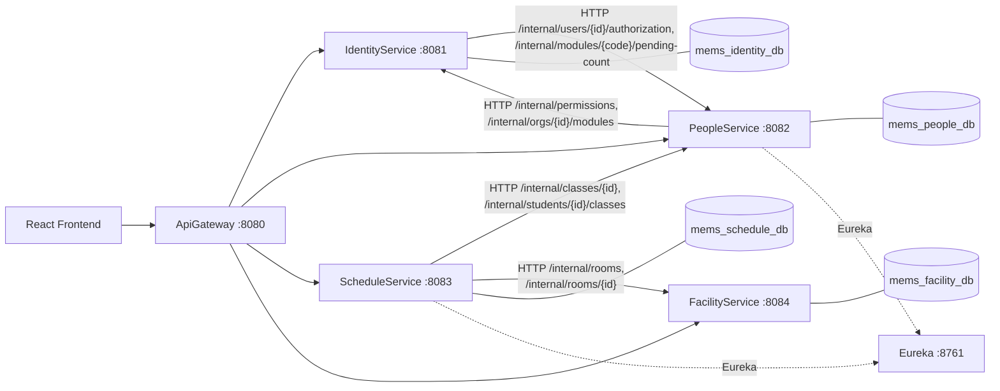

# MEMS — Phase 2: Kiến trúc hiện tại (Stage 0)

Ngày lập: 2026-11-20 · Nhánh `fixFlowCreateEmployee` · HEAD `fb054d4d0ebb704522465f9762cd1d41790d4c7d`

Tài liệu này mô tả **đúng những gì source đang có**, không suy đoán từ tài liệu thiết kế cũ.
Mọi khẳng định dưới đây đều có file tham chiếu trong mục 10.

---

## 1. Tóm tắt điều hành

- MEMS là **4 microservice dữ liệu độc lập** (Identity, People, Schedule, Facility) + Gateway + Eureka, mỗi service một database MySQL riêng.
- Giao tiếp liên service hiện tại **100% là HTTP đồng bộ** qua API nội bộ `/internal/**`, xác thực bằng header `X-Internal-Api-Key`.
- **Không có message broker** (RabbitMQ/Kafka/AMQP/JMS) trong bất kỳ `pom.xml`, `application.properties`, `docker-compose.yml` hay source Java nào.
- Ba luồng dữ liệu đang có nguy cơ lệch (chính là CC-03/SCH-01/CLS-03/SCH-04):
  1. People đổi giáo viên lớp → `session.teacher_id` đã tạo **không đổi**.
  2. People đóng/hủy/kết thúc lớp → các buổi tương lai ở Schedule **không được xử lý**.
  3. Facility ghi nhận sự cố phòng/thiết bị → Schedule **không biết** buổi nào bị ảnh hưởng.
- Audit tổ chức hiện nằm ở **People** (`people_audit_log`), nhưng **chưa có API đọc**; Identity có `audit_log` nền tảng và endpoint `GET /api/v1/audit-logs` chỉ dành `SUPER_ADMIN`.
- People đã có `@EnableScheduling` và tiền lệ bảng retry bền vững `account_compensation`; Schedule và Facility **chưa bật** scheduling.

---

## 2. Dịch vụ và quyền sở hữu dữ liệu

| Service | Cổng | Database | Sở hữu (nguồn sự thật) | Không sở hữu |
|---|---:|---|---|---|
| IdentityService | 8081 | `mems_identity_db` | `account`, `organization`, `permission`, `permission_bundle`, `audit_log` (nền tảng), refresh token | Hồ sơ nhân sự, lớp, lịch, phòng |
| PeopleService | 8082 | `mems_people_db` | `staff_profile`, `department_member`, `member_position`, `school_class`, `class_student`, `subject`, `people_audit_log`, `account_compensation`, notification nội bộ | Tài khoản/mật khẩu (Identity), session lịch (Schedule), phòng/thiết bị (Facility) |
| ScheduleService | 8083 | `mems_schedule_db` | `session`, bản sao `class` (mirror), `schedule_resource_lock` | Giáo viên/lớp gốc (People), phòng (Facility) |
| FacilityService | 8084 | `mems_facility_db` | `classroom`, `equipment`, `equipment_status_log`, `incident_report` | Lịch sử dụng phòng (Schedule) |
| ApiGateway | 8080 | — | Định tuyến `/api/v1/**`, `/departments/**`, `/classes/**`… | — |
| EurekaServer | 8761 | — | Service registry | — |

Bằng chứng: `docker-compose.yml` (DB_URL từng service), `DB_11_16.sql` (DDL People/Facility), `backend/ScheduleService/src/test/resources/schedule-test-schema.sql`, `40_schedule_department_scope_catchup.sql`.

---

## 3. Sơ đồ thành phần

Ghi chú: Identity ↔ People là **hai chiều**; Schedule **chỉ đọc** People/Facility; Facility **không gọi** service nào.

---

## 4. Các luồng HTTP đồng bộ đang có

| Caller → Callee | Endpoint | Client | Timeout | Mục đích |
|---|---|---|---|---|
| People → Identity | `GET /internal/permissions` | `PeopleService/.../client/IdentityClient.java` | 3s/5s | Danh mục quyền (cache 30s) |
| People → Identity | `GET /internal/permissions/bundles` | `IdentityClient` | 3s/5s | Bundle quyền (cache 30s) |
| People → Identity | `GET /internal/orgs/{orgId}/modules` | `IdentityClient` | 3s/5s | Module đang active (cache 30s) |
| People → Identity | `GET /internal/orgs/{orgId}/modules/status` | `IdentityClient` | 3s/5s | Trạng thái module chi tiết |
| People → Identity | `POST /internal/accounts`… | `IdentityClient` | 3s/5s | Cấp tài khoản, reset mật khẩu |
| Identity → People | `GET /internal/users/{id}/authorization?orgId=` | `PeopleAuthorizationClient` | — | Ảnh chụp quyền hiệu lực |
| Identity → People | `GET /internal/modules/{code}/pending-count?orgId=` | `PeopleModuleClient` | — | Đếm yêu cầu chờ duyệt |
| Schedule → People | `GET /internal/classes/{classId}?orgId=` | `ScheduleService/.../client/PeopleClient.java` | 3s/5s | Trạng thái lớp, giáo viên, sĩ số |
| Schedule → People | `GET /internal/students/{studentId}/classes?orgId=` | `PeopleClient` | 3s/5s | Lịch của học sinh |
| Schedule → Facility | `GET /internal/rooms/{roomId}?orgId=` | `ScheduleService/.../client/FacilityClient.java` | 3s/5s | Trạng thái phòng, thiết bị hỏng |
| Schedule → Facility | `GET /internal/rooms?orgId=&departmentId=` | `FacilityClient` | 3s/5s | Gợi ý phòng |
| Gateway → các service | Theo `Path=` | `backend/ApiGateway/src/main/resources/application.yml` | — | Định tuyến |

**Không có** luồng People → Schedule và Facility → Schedule. Đây là khoảng trống trung tâm của Phase 2.

---

## 5. Transaction hiện tại và điểm chèn Outbox

### 5.1 People — đổi giáo viên lớp

- `SchoolClassService.assignTeacher(classId, request, reassign)` (`@Transactional`).
- Ghi nghiệp vụ: `SchoolClassRepository.assignTeacher` — `UPDATE school_class SET teacher_id=?, needs_reassignment=FALSE, version=version+1`.
- Ghi audit cùng transaction: `PeopleAuditService.record` → `INSERT people_audit_log`.
- **Điểm chèn outbox:** ngay sau khi `repository.assignTeacher(...) > 0`, trước `return after`.
- Dữ liệu cần cho event: `classId`, `previousTeacherId` (từ `before.teacher()`), `newTeacherId` (`after.teacher()`), `version` sau cập nhật, `orgId`, `occurredAt`.

### 5.2 People — vòng đời lớp

`ClassStatusService` (`@Transactional` từng method):

| Method | Ghi nghiệp vụ | Điểm chèn outbox |
|---|---|---|
| `refresh(orgId, today)` | `transition` CHUA_BAT_DAU→DANG_DIEN_RA / DANG_DIEN_RA→DA_KET_THUC + `class_status_log` | Sau mỗi `transition > 0` |
| `cancel(...)` | `cancel` (0 học sinh) hoặc `requestCancel` | Sau nhánh hủy trực tiếp; nhánh yêu cầu duyệt phát event `requested` riêng |
| `approveCancel(...)` | `approveCancel` + status log + close event | Sau `approveCancel > 0` |
| `requestClose(...)` | `requestClose` (close_state=PENDING) | Sau `requestClose > 0` |
| `approveClose(...)` | `approveClose` (close_state=CLOSED) | Sau `approveClose > 0` |
| `reopen(...)` | `reopen` (CLOSED→NONE) | Sau `reopen > 0` |

Lưu ý: `refresh` hiện chạy theo `@Scheduled(cron="0 5 0 * * *")` và cả trong mọi thao tác lớp (`refreshOrganization`). Outbox insert phải nằm trong chính transaction của `refresh`, không gọi HTTP sau commit.

### 5.3 Facility — sự cố

`FacilityService` (`@Transactional`):

- `reportIssue` (dòng 177): `INSERT incident_report` (status `open`), set `equipment.status='broken'`, ghi `equipment_status_log`.
- `resolveIssue` (dòng 197): `UPDATE incident_report status='resolved'`, có thể khôi phục `equipment.status` và ghi log.
- **Điểm chèn outbox:** sau khi insert/update sự cố thành công, cùng transaction với thay đổi thiết bị.
- Dữ liệu cần: `incidentId`, `equipmentId`, `roomId` (lấy từ `equipment.room_id`), `status`, `orgId`, `occurredAt`.

### 5.4 Schedule — tạo/sửa buổi học

`ScheduleService.create/update` (`@Transactional`):

1. Gọi People `classInfo` và Facility `room` **bên trong transaction**.
2. `ensureClassMirror` upsert bảng `class` (mirror) — chỉ lưu tên/môn/status `draft|ongoing`/ngày.
3. `lockResources` ghi `schedule_resource_lock`.
4. `INSERT/UPDATE session` với `teacher_id` **sao chép tại thời điểm tạo**.

Hệ quả: transaction Schedule có phụ thuộc mạng ra ngoài; và `session` là **bản sao lịch sử** của giáo viên.

---

## 6. Rủi ro lệch dữ liệu (đối chiếu mã Phase 2)

| Mã | Rủi ro đã kiểm chứng | Cơ chế hiện tại | Hệ quả |
|---|---|---|---|
| SCH-01 | `session.teacher_id` giữ giáo viên cũ sau khi lớp đổi giáo viên | Không có event; `ScheduleService.resolveTeacher` chỉ chặn chọn sai giáo viên khi tạo mới | Giáo viên mới không thấy buổi cũ; giáo viên cũ vẫn thấy lịch |
| CLS-03 | Lớp `DA_HUY`/`CLOSED` không lan sang session tương lai | `requireClass` chặn **tạo mới**; không đụng session đã có | Lịch “mồ côi” vẫn hiển thị cho giáo viên/học sinh |
| SCH-04 | Sự cố phòng/thiết bị không đến Schedule | `validateRoom`/`roomSuggestions` chỉ kiểm tra tại thời điểm tạo/sửa | Buổi đã xếp vào phòng hỏng không được cảnh báo |
| CC-03 | Không có event bền vững giữa service | Chỉ HTTP đồng bộ, không outbox | Lỗi mạng/timeout làm mất đồng bộ vĩnh viễn |
| CC-06 | Audit tổ chức không đọc được | `people_audit_log` chỉ ghi; Identity audit chỉ `SUPER_ADMIN` | Owner không có nhật ký hoạt động tổ chức |

Rủi ro phụ đã thấy trong source:

- `ScheduleService.ensureClassMirror` chỉ cập nhật mirror khi có thao tác lên session; đổi tên/trạng thái lớp ở People không tự lan sang mirror.
- `IdentityService.AuditLogService.getAuditLogs` bắt mọi `Exception` và trả `items=[]` — che lỗi DB (sẽ xử lý ở CC-06 theo hướng không đổi hành vi nền tảng nếu ngoài phạm vi).
- People gọi Identity đồng bộ trong guard module ở mọi thao tác ghi; Identity cache metadata 30 giây.

---

## 7. Bảo mật liên service hiện tại

- Header `X-Internal-Api-Key`, so sánh constant-time, cấu hình qua `INTERNAL_API_KEY`.
- `InternalApiFilter` tồn tại ở **Identity, People, Facility**; các service này `permitAll` `/internal/**` và để filter chặn key sai.
- **ScheduleService chưa có `InternalApiFilter`**; `SecurityConfig` của Schedule chỉ mở `/departments/*/schedules*` và `/schedules/me`, còn `anyRequest().denyAll()`. Muốn nhận event qua HTTP phải bổ sung filter + matcher nội bộ.
- JWT HS256, issuer `mems-identity`; role `ORG_OWNER` được ánh xạ thành `OWNER`.
- Gateway định tuyến `/api/v1/audit-logs/**` → Identity (chỉ `SUPER_ADMIN`). Chưa có route audit của People.

---

## 8. Hạ tầng message broker

- Không có dependency `spring-boot-starter-amqp`, `spring-kafka`, JMS hay ActiveMQ trong bất kỳ `pom.xml` nào.
- `docker-compose.yml` chỉ có Eureka, Gateway, 4 service và MySQL; không có RabbitMQ/Kafka.
- Không có `@EnableScheduling` ở Schedule/Facility; People có `@EnableScheduling` (`PeopleServiceApplication`).
- Kết luận: Phase 2 phải dùng **Database Outbox + HTTP relay** (Phương án B) trừ khi người dùng quyết định bổ sung broker.

---

## 9. Khoảng trống cần lấp (đầu vào cho Stage 1)

1. Bảng `outbox_event` ở **People** và **Facility** (DB riêng từng service).
2. Endpoint nhận event nội bộ ở **Schedule** (`/internal/events/**`) + `InternalApiFilter` + `SecurityConfig` matcher.
3. Bảng `inbox_event` (idempotency) và bảng trạng thái ảnh hưởng (`schedule_impacted_session` hoặc tương đương) ở Schedule.
4. Publisher định kỳ có khóa/lô/backoff; cấu hình URL Schedule cho People/Facility (compose hiện **thiếu** `SCHEDULE_SERVICE_URL` ở hai service này).
5. API `GET /audit-logs` phía People + quyền `org.audit.view` trong `PermissionCatalog` (hiện **chưa có**) + route Gateway.
6. Quyết định nghiệp vụ còn mở: Q8 (giữ lớp khi chuyển phòng), Q19 (ai xem audit ngoài Owner), quy tắc tự động thay giáo viên buổi tương lai, quy tắc hủy session khi lớp đóng/hủy.

---

## 10. Bằng chứng đã đọc

| Nội dung | File |
|---|---|
| Cấu hình service/DB/env | `docker-compose.yml`, `backend/*/src/main/resources/application.properties` |
| Route Gateway | `backend/ApiGateway/src/main/resources/application.yml` |
| Client liên service | `backend/PeopleService/.../client/IdentityClient.java`, `backend/IdentityService/.../client/PeopleAuthorizationClient.java`, `PeopleModuleClient.java`, `backend/ScheduleService/.../client/PeopleClient.java`, `FacilityClient.java` |
| API nội bộ | `PeopleService/.../controller/InternalScheduleLookupController.java`, `FacilityService/.../controller/InternalRoomController.java` |
| Bảo mật | `backend/*/src/main/java/com/mems/security/SecurityConfig.java`, `InternalApiFilter.java` |
| Đổi giáo viên | `PeopleService/.../service/SchoolClassService.java`, `.../repository/SchoolClassRepository.java` |
| Vòng đời lớp | `PeopleService/.../service/ClassStatusService.java`, `.../repository/ClassStatusRepository.java` |
| Sự cố | `FacilityService/.../service/FacilityService.java` |
| Session/mirror | `ScheduleService/.../service/ScheduleService.java`, `ScheduleService/src/test/resources/schedule-test-schema.sql`, `40_schedule_department_scope_catchup.sql` |
| Audit | `PeopleService/.../service/PeopleAuditService.java`, `DB_11_16.sql` (`people_audit_log`), `IdentityService/.../service/AuditLogService.java`, `IdentityService/.../controller/AuditLogController.java` |
| Danh mục quyền | `IdentityService/.../service/PermissionCatalog.java` (không có `org.audit.view`) |
| Tiền lệ retry bền vững | `PeopleService/.../service/AccountCompensationService.java`, bảng `account_compensation` |

---

## 11. Kết luận Stage 0

Source hiện tại **đủ căn cứ** để triển khai:
- Outbox + inbox + relay HTTP (CC-03),
- Event đổi giáo viên và đánh dấu buổi bị ảnh hưởng (SCH-01),
- Event sự cố và đánh dấu buổi bị ảnh hưởng (SCH-04),
- API audit tổ chức (CC-06).

Những phần **chưa đủ căn cứ nghiệp vụ** (phải chờ quyết định): tự động đổi giáo viên toàn bộ buổi tương lai, tự động hủy session khi lớp đóng/hủy, xử lý enrollment, ai ngoài Owner được xem audit. Các phần này sẽ được thiết kế ở dạng event + trạng thái “cần xử lý”, **không tự thay đổi dữ liệu lịch**.
