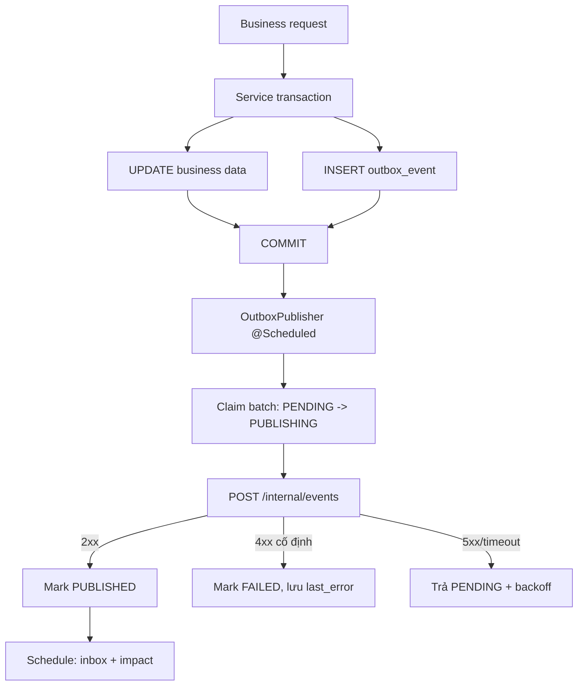
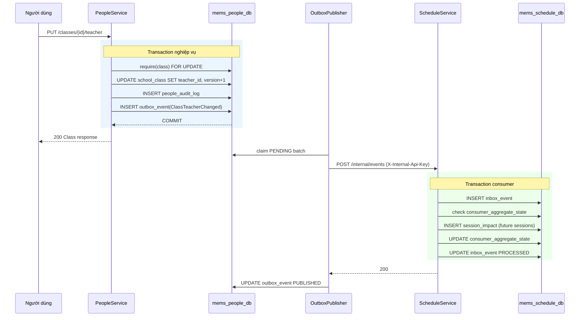
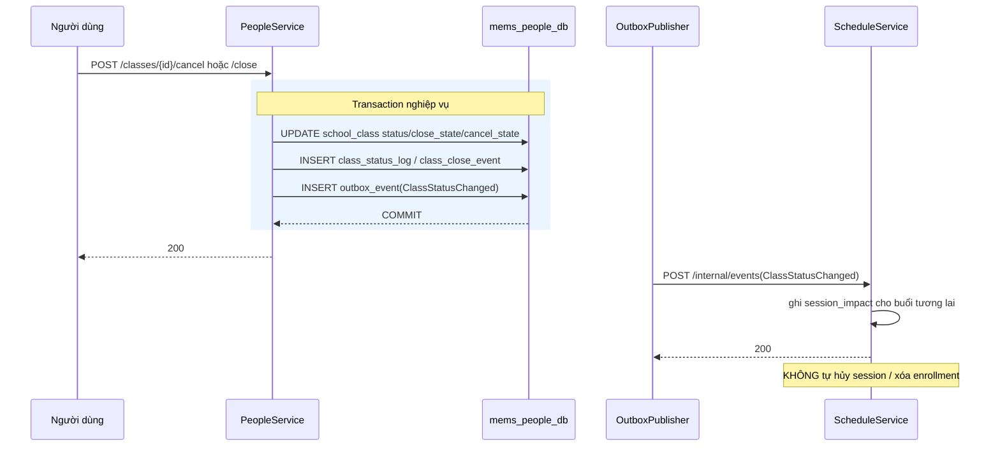
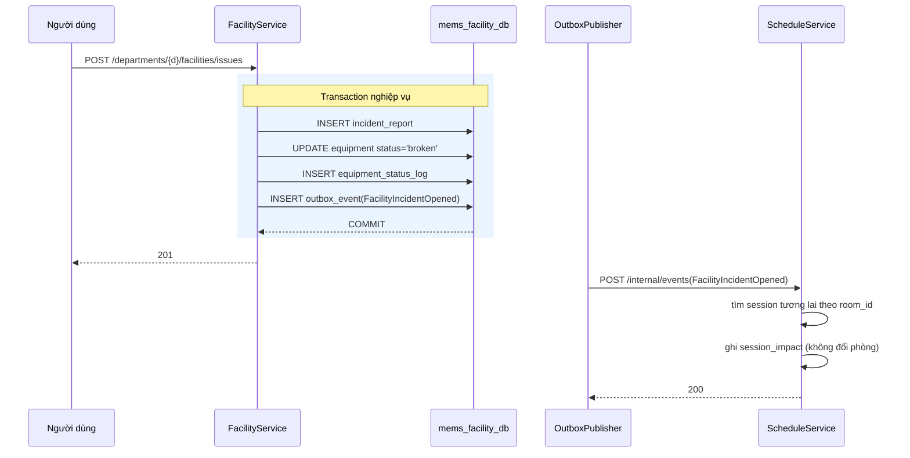
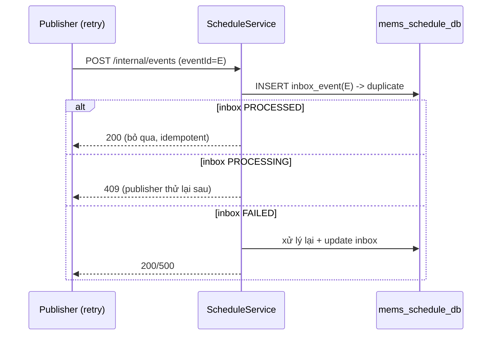
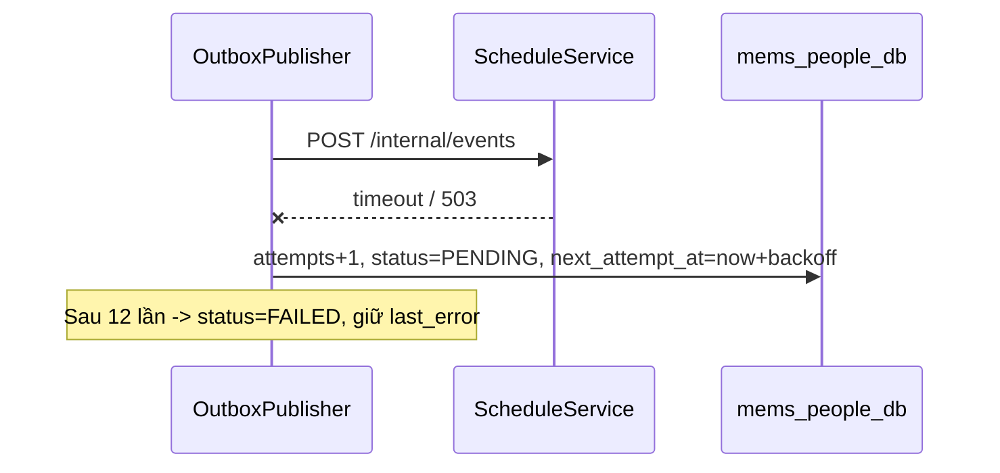
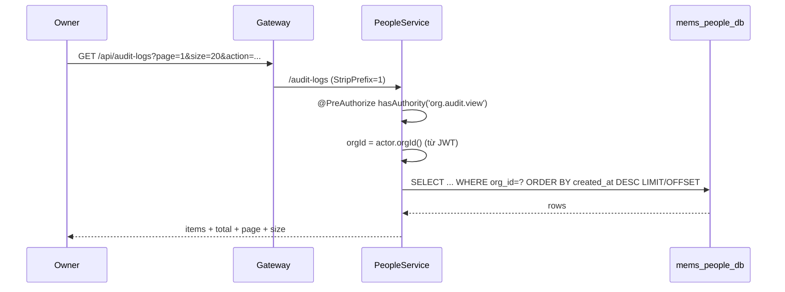
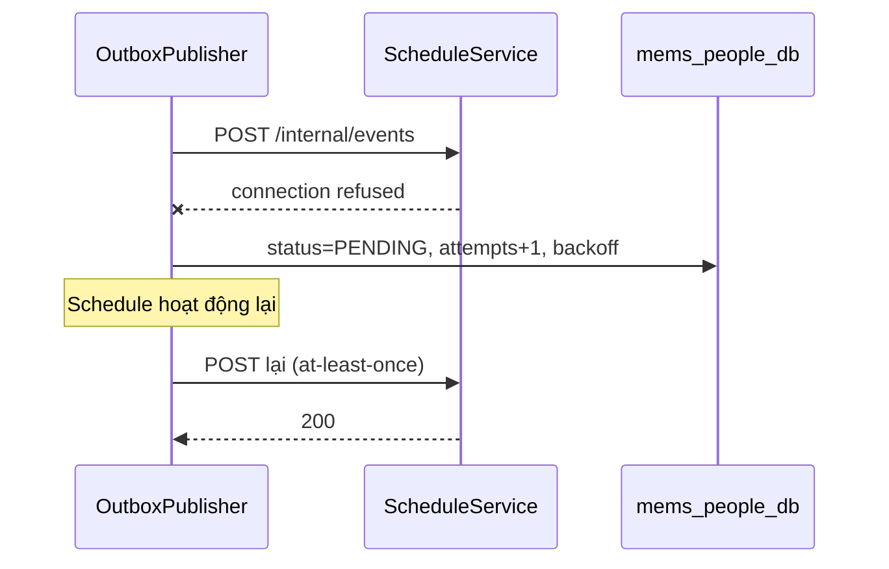

# MEMS — Phase 2: Thiết kế Transactional Outbox (Stage 1)

Ngày lập: 2026-11-20 · Nhánh `fixFlowCreateEmployee` · HEAD `fb054d4d0ebb704522465f9762cd1d41790d4c7d`

Tài liệu thiết kế, **chưa triển khai ở bước này**. Mọi con số/thời gian dưới đây là
**Đề xuất kỹ thuật**, không phải quy tắc nghiệp vụ đã chốt.

Tham chiếu hiện trạng: [PHASE_2_CURRENT_ARCHITECTURE.md](PHASE_2_CURRENT_ARCHITECTURE.md).

---

## 1. Mục tiêu và ràng buộc

Mục tiêu:

1. Thay đổi nghiệp vụ và sự kiện được ghi **cùng một transaction** tại service sở hữu dữ liệu.
2. Mất kết nối/timeout không làm mất sự kiện; sự kiện được gửi lại.
3. Consumer xử lý lặp không làm sai dữ liệu.
4. Có thể tra cứu sự kiện lỗi, replay có kiểm soát.
5. Dữ liệu cuối cùng hội tụ giữa People/Facility và Schedule.

Ràng buộc bắt buộc:

- **At-least-once**, không tuyên bố exactly-once.
- Không dùng `@Async`, `@TransactionalEventListener` hay in-memory queue làm cơ chế **duy nhất**.
- Không gửi event trước khi transaction commit.
- Không xóa event lỗi sau một lần gửi.
- Retry có giới hạn, backoff tăng dần, trạng thái lỗi tra cứu được.
- Replay thủ công phải có quyền và để lại dấu vết.
- Không tự thay đổi nghiệp vụ chưa chốt (giáo viên buổi tương lai, hủy session, đổi phòng).

---

## 2. So sánh phương án

| Tiêu chí | A — RabbitMQ + Outbox | B — DB Outbox + HTTP relay | C — Hạ tầng sự kiện sẵn có |
|---|---|---|---|
| Độ phức tạp | Cao: broker, exchange/queue, DLQ, vận hành | Trung bình: bảng + scheduler + endpoint nội bộ | Không có hạ tầng nào để tái sử dụng |
| Độ tin cậy | Cao nếu broker vận hành đúng | Cao trong phạm vi DB + retry; phụ thuộc HTTP | Không đạt: chỉ có HTTP đồng bộ |
| Retry | Có sẵn DLQ/retry của broker | Tự thiết kế (bounded, backoff) | Không có |
| Idempotency | Vẫn phải làm inbox phía consumer | Inbox `event_id` | Không có |
| Khả năng mở rộng | Tốt khi nhiều consumer | Đủ cho 4 service, 3 luồng event | — |
| Triển khai hiện tại | **Chưa có broker** (đã kiểm chứng) | Chỉ cần MySQL + Spring scheduler | — |
| Chi phí vận hành | Thêm container, monitoring, backup broker | Không thêm hạ tầng; thêm bảng + job | 0 |
| Phù hợp MEMS Phase 2 | Không tương xứng quy mô | **Có** | Không |

**Quyết định (đề xuất): Phương án B.**

Lý do:

- `docker-compose.yml` và toàn bộ `pom.xml` không có broker; thêm RabbitMQ là thay đổi hạ tầng
  vận hành ngoài phạm vi được giao.
- Outbox trong MySQL vẫn bảo đảm **không mất sự kiện** khi transaction commit.
- HTTP relay dùng đúng cơ chế xác thực nội bộ đã có (`X-Internal-Api-Key`).
- Khi tương lai có broker, chỉ cần thay tầng transport; contract event và inbox giữ nguyên.

---

## 3. Kiến trúc thành phần

| Thành phần | Service | Trách nhiệm |
|---|---|---|
| `OutboxEventRepository` | People, Facility | `INSERT` outbox trong transaction nghiệp vụ |
| `OutboxPublisher` (`@Scheduled`) | People, Facility | Claim lô event đến hạn, gọi HTTP relay, cập nhật trạng thái |
| `EventRelayClient` | People, Facility | `POST {SCHEDULE_SERVICE_URL}/internal/events` với `X-Internal-Api-Key` |
| `InternalEventController` | Schedule | Nhận event, trả 2xx/4xx/5xx theo ngữ nghĩa |
| `InboxService` | Schedule | Chống xử lý trùng theo `(event_id, consumer_name)` |
| `ConsumerStateRepository` | Schedule | Chặn event cũ ghi đè theo `aggregate_version`/`occurred_at` |
| `SessionImpactRepository` | Schedule | Lưu buổi học bị ảnh hưởng (không sửa session) |
| `ImpactQueryController` | Schedule | API cho người quản lý lịch xem buổi bị ảnh hưởng |
| `OutboxReplayController` | People, Facility | Replay thủ công, chỉ OWNER, ghi dấu replay |

Luồng tổng quát:



---

## 4. Thiết kế bảng Outbox (People, Facility)

Mỗi service sở hữu database riêng nên **mỗi DB có bảng outbox riêng** (cùng cấu trúc).

```sql
CREATE TABLE IF NOT EXISTS outbox_event (
  id                BIGINT       NOT NULL AUTO_INCREMENT,
  event_id          CHAR(36)     NOT NULL,
  aggregate_type    VARCHAR(40)  NOT NULL,
  aggregate_id      CHAR(36)     NOT NULL,
  aggregate_version BIGINT       NULL,
  event_type        VARCHAR(80)  NOT NULL,
  event_version     INT          NOT NULL DEFAULT 1,
  organization_id   CHAR(36)     NOT NULL,
  correlation_id    CHAR(36)     NULL,
  payload           JSON         NOT NULL,
  status            VARCHAR(20)  NOT NULL DEFAULT 'PENDING',
  attempts          INT          NOT NULL DEFAULT 0,
  next_attempt_at   DATETIME(3)  NOT NULL,
  locked_until      DATETIME(3)  NULL,
  last_error        VARCHAR(1000) NULL,
  replayed_at       DATETIME(3)  NULL,
  replayed_by       CHAR(36)     NULL,
  created_at        DATETIME(3)  NOT NULL,
  published_at      DATETIME(3)  NULL,
  PRIMARY KEY (id),
  UNIQUE KEY uq_outbox_event_id (event_id),
  KEY idx_outbox_due (status, next_attempt_at),
  KEY idx_outbox_aggregate (aggregate_type, aggregate_id, aggregate_version),
  KEY idx_outbox_org_created (organization_id, created_at)
) ENGINE=InnoDB DEFAULT CHARSET=utf8mb4 COLLATE=utf8mb4_unicode_ci;
```

### 4.1. Vì sao từng cột

| Cột | Lý do |
|---|---|
| `id` | Khóa nội bộ tăng dần, hỗ trợ phân trang ổn định và thứ tự chèn |
| `event_id` | ID trong envelope; **unique** để chống ghi trùng và làm khóa idempotency |
| `aggregate_type` / `aggregate_id` | Truy vết event thuộc lớp/sự cố nào; hỗ trợ kiểm tra thứ tự |
| `aggregate_version` | Chặn event cũ ghi đè; NULL khi nguồn không có cột version (sự cố) |
| `event_type` / `event_version` | Định tuyến consumer và tiến hóa schema |
| `organization_id` | Cách ly tổ chức; publisher/consumer luôn kiểm tra |
| `correlation_id` | Truy vết một thao tác qua nhiều service |
| `payload` | JSON tối thiểu, không chứa bí mật |
| `status` | `PENDING → PUBLISHING → PUBLISHED | FAILED` |
| `attempts` | Đếm số lần gửi; giới hạn retry |
| `next_attempt_at` | Backoff, tránh retry dồn dập |
| `locked_until` | Chống hai publisher xử lý cùng một event; phát hiện publisher chết |
| `last_error` | Tra cứu nguyên nhân lỗi |
| `replayed_at` / `replayed_by` | Dấu vết replay thủ công |
| `created_at` / `published_at` | Đo độ trễ và lưu trữ |

### 4.2. Unique và index

- `UNIQUE(event_id)`: một envelope chỉ tồn tại một lần trong outbox.
- `(status, next_attempt_at)`: publisher quét đúng lô đến hạn.
- `(aggregate_type, aggregate_id, aggregate_version)`: kiểm tra thứ tự/điều tra.
- `(organization_id, created_at)`: tra cứu theo tổ chức.

### 4.3. Phân trang và lưu trữ

- Publisher không phân trang toàn bộ; luôn `LIMIT` theo lô (đề xuất 50).
- API tra cứu outbox (nếu cần) dùng `id` làm con trỏ (`WHERE id > ? ORDER BY id LIMIT ?`),
  không dùng `OFFSET` lớn.
- Đề xuất giữ event `PUBLISHED` **90 ngày** để điều tra; purge là job riêng, **không** nằm trong
  migration. Event `FAILED` không tự xóa.

---

## 5. Thiết kế bảng Inbox / State / Impact (Schedule)

```sql
CREATE TABLE IF NOT EXISTS inbox_event (
  event_id        CHAR(36)      NOT NULL,
  consumer_name   VARCHAR(80)   NOT NULL,
  event_type      VARCHAR(80)   NOT NULL,
  organization_id CHAR(36)      NOT NULL,
  status          VARCHAR(20)   NOT NULL DEFAULT 'PROCESSING',
  attempts        INT           NOT NULL DEFAULT 0,
  error_message   VARCHAR(1000) NULL,
  received_at     DATETIME(3)   NOT NULL,
  processed_at    DATETIME(3)   NULL,
  PRIMARY KEY (event_id, consumer_name),
  KEY idx_inbox_status (consumer_name, status, received_at)
) ENGINE=InnoDB DEFAULT CHARSET=utf8mb4 COLLATE=utf8mb4_unicode_ci;

CREATE TABLE IF NOT EXISTS consumer_aggregate_state (
  consumer_name     VARCHAR(80) NOT NULL,
  aggregate_type    VARCHAR(40) NOT NULL,
  aggregate_id      CHAR(36)    NOT NULL,
  last_version      BIGINT      NULL,
  last_occurred_at  DATETIME(3) NULL,
  PRIMARY KEY (consumer_name, aggregate_type, aggregate_id)
) ENGINE=InnoDB DEFAULT CHARSET=utf8mb4 COLLATE=utf8mb4_unicode_ci;

CREATE TABLE IF NOT EXISTS session_impact (
  id           CHAR(36)     NOT NULL,
  org_id       CHAR(36)     NOT NULL,
  session_id   CHAR(36)     NOT NULL,
  source_type  VARCHAR(40)  NOT NULL,
  source_id    CHAR(36)     NOT NULL,
  event_id     CHAR(36)     NOT NULL,
  status       VARCHAR(20)  NOT NULL DEFAULT 'OPEN',
  details      JSON         NULL,
  created_at   DATETIME(3)  NOT NULL,
  resolved_at  DATETIME(3)  NULL,
  PRIMARY KEY (id),
  UNIQUE KEY uq_session_impact (session_id, source_type, event_id),
  KEY idx_impact_org_status (org_id, status),
  KEY idx_impact_source (source_type, source_id)
) ENGINE=InnoDB DEFAULT CHARSET=utf8mb4 COLLATE=utf8mb4_unicode_ci;
```

Ý nghĩa:

- `inbox_event`: khóa idempotency theo cặp `(event_id, consumer_name)`. Consumer khác nhau có thể
  cùng nhận một event.
- `consumer_aggregate_state`: chặn event đến trễ/sai thứ tự. Với lớp dùng `aggregate_version`
  (cột `school_class.version`). Với sự cố (không có version) dùng `last_occurred_at`.
- `session_impact`: **không sửa** `session`; chỉ ghi nhận “buổi này cần người có quyền xử lý”.
  Unique `(session_id, source_type, event_id)` bảo đảm replay/trùng không tạo bản ghi lặp.

---

## 6. Quy tắc transaction

### 6.1. Ghi nghiệp vụ + outbox

```text
BEGIN
  UPDATE school_class SET teacher_id = ?, version = version + 1 ...
  INSERT people_audit_log ...
  INSERT outbox_event(event_id, event_type=ClassTeacherChanged, ...)
COMMIT
```

Quy tắc code:

- `OutboxEventRepository.append(...)` được gọi **bên trong** method `@Transactional` của service.
- Không dùng `REQUIRES_NEW` cho outbox (sẽ tách khỏi transaction nghiệp vụ).
- Không gọi HTTP trong transaction nghiệp vụ.
- Nếu transaction rollback, outbox không tồn tại — đây là hành vi đúng.

### 6.2. Gửi event

- Publisher chạy **sau commit**, ở scheduler riêng, đọc từ DB.
- Không dùng `@TransactionalEventListener(AFTER_COMMIT)` làm cơ chế bảo đảm duy nhất.

---

## 7. Thuật toán Publisher

Chu kỳ đề xuất: `fixedDelay = 5000ms`, `initialDelay = 10000ms`, mỗi lô 50 event.

1. **Claim** (một câu UPDATE nguyên tử, MySQL 8.0):
   ```sql
   UPDATE outbox_event
   SET status='PUBLISHING', locked_until = NOW(3) + INTERVAL 60 SECOND
   WHERE status='PENDING' AND next_attempt_at <= NOW(3)
   ORDER BY id
   LIMIT 50;
   ```
   Sau đó `SELECT * FROM outbox_event WHERE status='PUBLISHING' AND locked_until > NOW(3) AND ...`?
   Cách an toàn hơn: claim theo `id` đã chọn bằng `SELECT ... FOR UPDATE SKIP LOCKED` trong một
   transaction ngắn, rồi UPDATE các `id` đó. MySQL hiện tại là 8.0.41 (theo dump), hỗ trợ
   `SKIP LOCKED`.

   Pseudo:
   ```sql
   START TRANSACTION;
   SELECT id FROM outbox_event
    WHERE status='PENDING' AND next_attempt_at <= NOW(3)
    ORDER BY id LIMIT 50
    FOR UPDATE SKIP LOCKED;
   UPDATE outbox_event
      SET status='PUBLISHING', locked_until = NOW(3) + INTERVAL 60 SECOND
    WHERE id IN (...);
   COMMIT;
   ```
   Hai publisher chạy đồng thời sẽ nhận hai tập `id` rời nhau.

2. **Gửi** từng event: `POST {schedule}/internal/events`, body là envelope, header
   `X-Internal-Api-Key`, timeout 3s/5s.

3. **Phân loại kết quả**:
   - `2xx`: `status='PUBLISHED'`, `published_at=NOW(3)`, `locked_until=NULL`, `last_error=NULL`.
   - `409` (consumer đang xử lý song song event khác) → **thử lại** như lỗi tạm thời
     (`attempts + 1`, backoff), vì consumer chưa chắc đã xử lý xong.
   - `400` do payload không hợp lệ vĩnh viễn → `FAILED` (không thử lại vô ích).
   - `5xx`, timeout, lỗi mạng: `attempts = attempts + 1`.
     - Nếu `attempts >= 12`: `status='FAILED'` (dead-letter logic), giữ `last_error`.
     - Ngược lại: `status='PENDING'`, `next_attempt_at = NOW + backoff(attempts)`.
   - Backoff đề xuất: `min(5s * 2^(attempts-1), 1h)`.

4. **Publisher chết giữa chừng**: bản ghi kẹt `PUBLISHING` với `locked_until` quá hạn được job
   thu hồi:
   ```sql
   UPDATE outbox_event
      SET status='PENDING', locked_until=NULL,
          attempts=attempts+1,
          next_attempt_at=NOW(3)
    WHERE status='PUBLISHING' AND locked_until < NOW(3);
   ```
   Nếu HTTP đã thành công nhưng chưa kịp đánh dấu, event được gửi lại → **at-least-once** →
   consumer chống trùng bằng inbox.

5. **Không mất event**: event chỉ rời `PENDING` khi gửi thành công hoặc hết retry; không có nhánh
   nào xóa event.

6. **Giới hạn tải**: mỗi chu kỳ tối đa một lô; lỗi liên tiếp có thể mở “circuit breaker” đơn giản
   bằng cách dừng chu kỳ khi lô toàn lỗi (đề xuất, không bắt buộc ở bản đầu).

---

## 8. Thuật toán Consumer (Schedule)

Endpoint đề xuất: `POST /internal/events` (permitAll + `InternalApiFilter`).

Xử lý một event:

1. Kiểm tra envelope: `eventId`, `eventType`, `eventVersion`, `organizationId`, `payload` bắt buộc.
2. `INSERT INTO inbox_event(event_id, consumer_name, ...)`. Nếu **duplicate key**:
   - Nếu bản ghi cũ `PROCESSED` → trả `200` (idempotent).
   - Nếu `PROCESSING` (request song song) → trả `409` để publisher thử lại sau.
   - Nếu `FAILED` → cho phép xử lý lại (update attempts), trả kết quả mới.
3. Mở transaction:
   - Kiểm tra `consumer_aggregate_state` (version/occurredAt) — event cũ hơn → đánh dấu
     `PROCESSED` với ghi chú `stale`, **không** áp dụng.
   - Áp dụng handler (mục 9).
   - Cập nhật `consumer_aggregate_state`.
   - `UPDATE inbox_event SET status='PROCESSED', processed_at=NOW(3)`.
   - COMMIT.
4. Lỗi xử lý: `UPDATE inbox_event SET status='FAILED', error_message=...`; trả `500` để publisher
   retry.

Cách ly tổ chức:

- Mọi truy vấn `session`/`class` mirror đều lọc `org_id` lấy từ envelope.
- Payload chứa `organizationId` khác envelope → `400`, không xử lý.
- Không tin `orgId` từ query string.

---

## 9. Hành vi theo từng event

### 9.1. `ClassTeacherChanged` (SCH-01)

- Kiểm tra `aggregate_version` > `consumer_aggregate_state.last_version`; nếu không, bỏ qua (stale).
- Tìm các buổi **chưa diễn ra** của lớp:
  ```sql
  SELECT s.id FROM session s JOIN `class` c ON c.id=s.class_id
  WHERE s.class_id=? AND c.org_id=? AND s.deleted_at IS NULL
    AND s.status='scheduled' AND s.start_time > NOW(3)
  ```
- Ghi `session_impact` cho từng buổi, `source_type='CLASS_TEACHER_CHANGED'`,
  `details = {previousTeacherId,newTeacherId,classVersion}`.
- **Không** cập nhật `session.teacher_id`.
- **Không** đổi `class` mirror (mirror không có cột giáo viên).
- Lý do: chưa có quyết định “tự động thay giáo viên toàn bộ buổi tương lai hay cần người xác nhận”
  (`MEMS_BUSINESS_DECISIONS_REQUIRED.md`, SCH-01).

### 9.2. `ClassStatusChanged` (CLS-03)

- Áp dụng cho thay đổi `status`/`closeState`/`cancelState`.
- Tìm buổi `scheduled` có `start_time > NOW(3)` của lớp.
- Ghi `session_impact` với `source_type='CLASS_STATUS_CHANGED'` và lý do (hủy/đóng/kết thúc).
- Cập nhật `class` mirror `status` (`draft|ongoing|closed|cancelled`) nếu cần hiển thị.
- **Không** tự hủy session, không xóa enrollment — chờ quyết định nghiệp vụ.
- Khi lớp được mở lại (`reopen`), consumer đánh dấu các impact cũ `RESOLVED`
  (`resolved_at=NOW`) thay vì xóa.

### 9.3. `FacilityIncidentOpened` (SCH-04)

- Xác định `roomId` từ payload (Facility lấy từ `equipment.room_id`).
- Tìm buổi **chưa diễn ra** dùng phòng:
  ```sql
  SELECT id FROM session
  WHERE org_id=? AND room_id=? AND status='scheduled'
    AND start_time > NOW(3) AND deleted_at IS NULL
  ```
- Ghi `session_impact` `source_type='FACILITY_INCIDENT'`, `source_id=incidentId`.
- Không đổi phòng, không xóa buổi.
- Không coi “thiết bị hỏng” là “phòng không dùng được” trừ khi payload nói rõ
  (`severity`/`roomUnusable`); bản đầu chỉ cảnh báo.

### 9.4. `FacilityIncidentResolved`

- Tìm các impact `OPEN` có `source_type='FACILITY_INCIDENT' AND source_id=incidentId`.
- Đánh dấu `RESOLVED` **chỉ khi** Session vẫn còn dùng đúng phòng đó và chưa bị người quản lý
  thay đổi thủ công.
- Không khôi phục session đã bị hủy/đổi phòng sau sự cố.

---

## 10. Retry, Dead-letter, Replay

| Trạng thái | Ý nghĩa | Hành động |
|---|---|---|
| `PENDING` | Chờ gửi | Publisher gửi khi đến `next_attempt_at` |
| `PUBLISHING` | Đang gửi | Publisher khác bỏ qua; quá `locked_until` thì thu hồi |
| `PUBLISHED` | Đã gửi thành công | Không gửi lại (trừ replay thủ công) |
| `FAILED` | Hết retry hoặc lỗi vĩnh viễn | Tra cứu, replay có quyền |

- Số lần thử tối đa: **12** (đề xuất).
- Backoff: 5s, 10s, 20s, 40s, 80s, 160s, 320s, 640s, 1280s, 2560s, 3600s, 3600s.
- Replay:
  - `POST /outbox/events/{eventId}/replay` (People, Facility).
  - Chỉ `OWNER` (`@PreAuthorize("hasRole('OWNER')")`), org lấy từ JWT, kiểm tra event thuộc org.
  - Đặt `status='PENDING'`, `next_attempt_at=NOW`, `attempts=0`, `locked_until=NULL`,
    `replayed_at=NOW`, `replayed_by=userId`.
  - Ghi audit: People dùng `people_audit_log` (`OUTBOX_EVENT_REPLAYED`); Facility dùng cột
    `replayed_at/replayed_by` của outbox làm dấu vết (chưa có bảng audit riêng).
- Không có retry vô hạn: sau 12 lần chuyển `FAILED` và dừng.

---

## 11. Sơ đồ sequence

### 11.1. People đổi giáo viên



### 11.2. People đóng/hủy lớp



### 11.3. Facility báo sự cố



### 11.4. Schedule nhận event trùng



### 11.5. Publisher gặp lỗi/timeout



### 11.6. Owner xem audit tổ chức



### 11.7. Retry khi Schedule tạm dừng



---

## 12. Migration đề xuất

Số migration hiện tại lớn nhất là **47** (`47_people_position_system_code.sql`). Đề xuất:

| File | DB | Nội dung |
|---|---|---|
| `48_people_outbox.sql` | `mems_people_db` | `outbox_event` + index |
| `49_facility_outbox.sql` | `mems_facility_db` | `outbox_event` + index |
| `50_schedule_inbox_impact.sql` | `mems_schedule_db` | `inbox_event`, `consumer_aggregate_state`, `session_impact` + index |

Nguyên tắc:

- Chỉ `CREATE TABLE IF NOT EXISTS` / thêm index có kiểm tra `information_schema` như migration 40.
- Không xóa/không sửa dữ liệu hiện có.
- Không chạy production; chỉ áp dụng local/test khi được yêu cầu.
- Không có migration nào cho Identity ở Phase 2 (quyền `org.audit.view` nằm trong
  `PermissionCatalog`; `IdentityDataInitializer` đồng bộ khi khởi động).

---

## 13. Cấu hình đề xuất

| Thuộc tính | Service | Mặc định | Ghi chú |
|---|---|---|---|
| `outbox.publisher.enabled` | People, Facility | `true` | Cho phép tắt trong test |
| `outbox.publisher.batch-size` | People, Facility | `50` | |
| `outbox.publisher.interval-ms` | People, Facility | `5000` | `fixedDelay` |
| `outbox.publisher.max-attempts` | People, Facility | `12` | |
| `outbox.publisher.lock-seconds` | People, Facility | `60` | |
| `SCHEDULE_SERVICE_URL` | People, Facility | `http://localhost:8083` | **Compose hiện thiếu**; cần bổ sung khi chạy Docker (file-only, không deploy) |

Bật `@EnableScheduling` ở Facility (People đã có). Schedule **không** cần scheduler cho consumer.

---

## 14. Kế hoạch kiểm thử (map 12 kịch bản bắt buộc)

| # | Kịch bản | Cách kiểm chứng đề xuất |
|---|---|---|
| 1 | Transaction thành công → có outbox | Test service + H2/MySQL test: gọi `assignTeacher`, assert 1 row |
| 2 | Transaction rollback → không outbox | Ép lỗi sau update (mock audit ném lỗi), assert 0 row |
| 3 | Publisher gửi thành công | Mock relay 200, assert `PUBLISHED` |
| 4 | Publisher timeout | Mock ném `ResourceAccessException`, assert `PENDING` + attempts |
| 5 | Consumer trả lỗi | Mock 500, assert retry |
| 6 | Retry | Chạy publisher 2 lần, assert attempts tăng và backoff |
| 7 | Event trùng | Gửi cùng `eventId` 2 lần, assert 1 impact |
| 8 | Hai publisher đồng thời | Hai thread claim, assert không trùng `id` |
| 9 | Sai thứ tự | Gửi version 3 rồi version 2, assert version 2 bị bỏ qua |
| 10 | Event version cũ | `eventVersion` không hỗ trợ → `400`/FAILED, không áp dụng |
| 11 | Cách ly tổ chức | Event org A chứa class org B → không tạo impact org B |
| 12 | Replay event thất bại | `FAILED` → replay endpoint → `PENDING`, có `replayed_by` |

Ghi chú: test tích hợp cần MySQL/Schedule chạy thật sẽ được đánh dấu `NOT_TESTED` nếu môi trường
offline không đáp ứng; không suy diễn pass từ unit test.

---

## 15. Điểm cần người dùng quyết định

1. **SCH-01:** Có tự động thay giáo viên cho mọi buổi tương lai không? (Thiết kế hiện tại:
   chỉ đánh dấu impact, chờ xác nhận.)
2. **CLS-03:** Lớp hủy/đóng thì buổi tương lai bị hủy hay chỉ cảnh báo? (Hiện tại: cảnh báo.)
3. **Enrollment:** Sinh viên được chuyển lớp/giữ lịch sử thế nào? (Không đụng trong Phase 2.)
4. **Q19:** Ngoài Owner, ai được xem audit tổ chức? (Mặc định: chỉ `org.audit.view`.)
5. **Thông báo:** Khi có impact, thông báo qua kênh nào? (Schedule chưa có bảng notification;
   Phase 2 chỉ cung cấp API danh sách impact.)

---

## 16. Giới hạn đã biết

- At-least-once: có thể gửi trùng; consumer phải idempotent.
- HTTP relay phụ thuộc Schedule; Schedule chết lâu → outbox tồn đọng (không mất).
- Outbox dùng chung DB với nghiệp vụ nên tăng nhẹ tải ghi; chấp nhận ở quy mô MEMS.
- Chưa có broker → không có fan-out nhiều consumer; nếu tương lai cần, thay transport.
- Không có exactly-once; không có distributed transaction.
