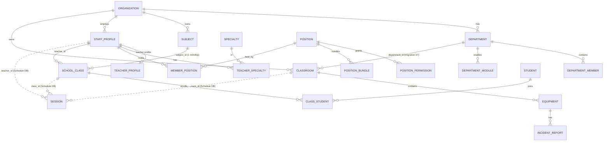
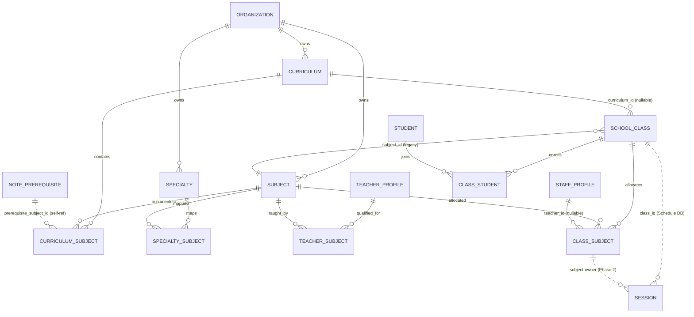

# Phase 1 — ERD (Hiện có + Đề xuất)

> Sơ đồ dưới đây phân biệt rõ **bảng đã có** và **bảng đề xuất**. Bảng đề xuất chưa tồn tại trong
> source; xem `database-schema.md` để biết cột/kiểu/constraint và `implementation-roadmap.md`
> để biết thứ tự triển khai. Quyết định nghiệp vụ: `D-01`…`D-12` trong
> `subject-business-requirements.md`.

---

## 1. Chú giải

| Ký hiệu | Ý nghĩa |
|---|---|
| Nền trắng | Bảng **đã có** tại HEAD `cdd03b8` |
| `[NEW]` | Bảng **đề xuất**, chưa có trong source |
| `||--o{` | 1–nhiều, có FK vật lý |
| `||..o{` | 1–nhiều, tham chiếu **logic** qua DB khác (không FK) |
| `}o--||` | nhiều–1 (phía trái là bảng chứa FK) |

---

## 2. ERD hiện có (rút gọn, đã kiểm chứng)

Ghi chú:

- `SUBJECT` **không** có FK vật lý tới `SPECIALTY`; quan hệ hiện chỉ là so tên
  (`specialty.name_unaccented = subject.name_unaccented` trong `TeacherRepository`).
- `SESSION` chỉ có DDL trong test schema Schedule; không có `org_id`, `subject_id`,
  không FK vật lý sang People/Facility.
- `DEPARTMENT_MODULE` là bảng nối `(department_id, module_code)`.
- `ORGANIZATION` không phải bảng trong People DB; `org_id` là cột trên từng bảng.

---

## 3. ERD đề xuất (Phase 1)

`[NEW]` trong sơ đồ trên: `CURRICULUM`, `CURRICULUM_SUBJECT`, `CLASS_SUBJECT`,
`SPECIALTY_SUBJECT`, `TEACHER_SUBJECT`, và cột `SCHOOL_CLASS.curriculum_id`.

---

## 4. Bảng quan hệ chi tiết

### 4.1. Quan hệ đã có (không đổi)

| Cha | Con | Cột | Bản số | FK vật lý | ON DELETE |
|---|---|---|---|---|---|
| `subject` | `school_class` | `subject_id` | 1–n (nullable) | Có, `(subject_id, org_id)` | RESTRICT |
| `staff_profile` | `school_class` | `teacher_id` | 1–n (nullable) | Có, `(teacher_id, org_id)` | RESTRICT |
| `school_class` | `class_student` | `class_id` | 1–n | Có | CASCADE |
| `student` | `class_student` | `student_id` | 1–n (nhưng UNIQUE student) | Có | CASCADE |
| `specialty` | `teacher_specialty` | `specialty_id` | 1–n | Có | CASCADE |
| `teacher_profile` | `teacher_specialty` | `user_id` | 1–n | Có | CASCADE |

### 4.2. Quan hệ đề xuất

| Cha | Con | Cột | Bản số | FK vật lý | ON DELETE | Ghi chú |
|---|---|---|---|---|---|---|
| `curriculum` | `curriculum_subject` | `curriculum_id` | 1–n | Có `(curriculum_id, org_id)` | CASCADE | Xoá curriculum xoá dòng định nghĩa |
| `subject` | `curriculum_subject` | `subject_id` | 1–n | Có `(subject_id, org_id)` | RESTRICT | Không xoá môn đang trong curriculum |
| `subject` | `curriculum_subject` | `prerequisite_subject_id` | 0–n | Có (nullable) | RESTRICT | Đề xuất 1 tiên quyết/môn (D-07) |
| `specialty` | `specialty_subject` | `specialty_id` | 1–n | Có | CASCADE | Ánh xạ danh mục |
| `subject` | `specialty_subject` | `subject_id` | 1–n | Có | RESTRICT | |
| `teacher_profile` | `teacher_subject` | `user_id` | 1–n | Có `(user_id, org_id)` | CASCADE | |
| `subject` | `teacher_subject` | `subject_id` | 1–n | Có | RESTRICT | Nguồn sự thật dạy môn |
| `curriculum` | `school_class` | `curriculum_id` | 0–n | Có (nullable) | RESTRICT | Lớp legacy NULL; ngừng curriculum thay vì xoá |
| `school_class` | `class_subject` | `class_id` | 1–n | Có | CASCADE | Snapshot môn của lớp |
| `subject` | `class_subject` | `subject_id` | 1–n | Có | RESTRICT | |
| `staff_profile` | `class_subject` | `teacher_id` | 0–n | Có (nullable) | RESTRICT | Giáo viên theo môn (D-09) |
| `curriculum` | `class_subject` | `curriculum_id` | 0–n | Có (nullable) | RESTRICT | Truy vết nguồn snapshot |

---

## 5. Ràng buộc và chỉ mục quan trọng

| Bảng | PK | UNIQUE | INDEX |
|---|---|---|---|
| `curriculum` | `id` | `(id, org_id)`, `(org_id, code)`, `(org_id, name_unaccented)` | `(org_id, is_active)` |
| `curriculum_subject` | `(curriculum_id, subject_id)` | `(curriculum_id, sequence_no)` | `(subject_id, org_id)` |
| `class_subject` | `(class_id, subject_id)` | — | `(org_id, subject_id)`, `(teacher_id)` |
| `specialty_subject` | `(specialty_id, subject_id)` | — | `(org_id, subject_id)` |
| `teacher_subject` | `(user_id, subject_id)` | — | `(org_id, subject_id, status)`, `(org_id, user_id)` |
| `subject` (đổi) | `id` | `(id, org_id)`, `(org_id, name_unaccented)`, `(org_id, code)` **UNIQUE khi chốt D-04** | `(org_id, is_active)` |

---

## 6. Phạm vi tổ chức (org isolation)

- Mọi bảng mới có `org_id` và mọi FK tổ hợp đều gồm `org_id` (ví dụ
  `(subject_id, org_id) → subject(id, org_id)`), ngăn tham chiếu chéo tổ chức.
- `curriculum_subject` không có `org_id` riêng? **Có** — thêm `org_id` để tiện lọc và FK tổ hợp;
  giá trị phải khớp curriculum và subject (kiểm ở service + FK tổ hợp).
- `class_subject` có `org_id` để lọc theo tổ chức/phòng ban mà không join nhiều bảng.

---

## 7. Ghi chú thiết kế

1. **`school_class.subject_id` không bị xoá.** Đây là môn chính legacy; `class_subject` mới là
   danh sách môn thực tế. Khi lớp chưa có `class_subject`, API mới suy ra một dòng `LEGACY`.
2. **`teacher_specialty` không bị xoá.** Giữ cho báo cáo nhân sự; `teacher_subject` là nguồn
   sự thật cho dạy môn.
3. **`curriculum_subject.term_no`** chỉ là số kỳ nội bộ chương trình. Bảng học kỳ thật
   (`academic_term`) thuộc Phase 2, không tạo ở đây để tránh trùng chức năng.
4. **`session`** thuộc Schedule DB; Phase 1 không thêm cột. Phase 2 sẽ cần `subject_id`/
   `class_subject` tham chiếu logic.
5. **Không có bảng `class_subject_teacher`** ở Phase 1: một môn/lớp một giáo viên (D-09).
   Nếu cần co-teaching, đó là thay đổi Phase sau.

---

## 8. Câu hỏi mở

1. D-01/D-02: có giữ `school_class.subject_id` làm môn chính không?
2. D-07: một hay nhiều tiên quyết?
3. D-09: có cần nhiều giáo viên/môn/lớp không?
4. Có cần bảng `curriculum_version` để lưu lịch sử sửa chương trình không (D-12)?
5. `curriculum_subject.org_id` có cần thiết hay suy từ `curriculum`?
