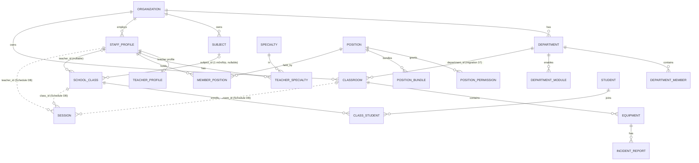
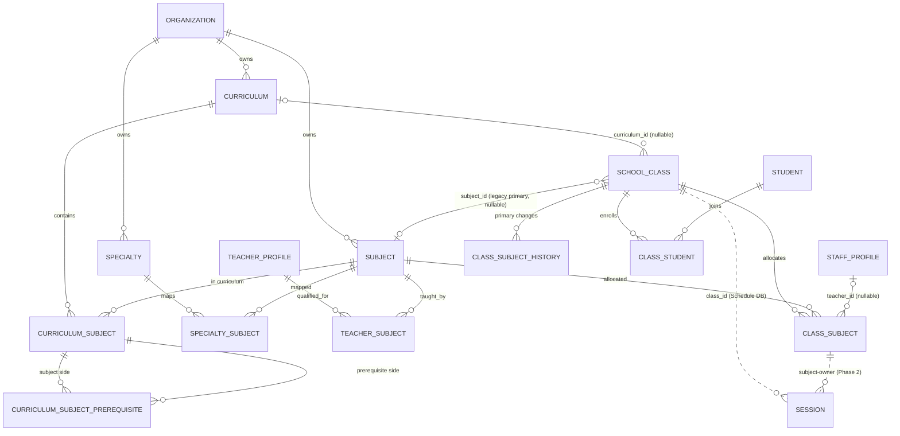

# Phase 1 — ERD (Hiện có + Đề xuất)

> Sơ đồ dưới đây phân biệt rõ **bảng đã có** và **bảng đề xuất**. Bảng đề xuất chưa tồn tại trong
> source; xem `database-schema.md` để biết cột/kiểu/constraint và `implementation-roadmap.md`
> để biết thứ tự triển khai.
> **Trạng thái quyết định:** `D-01`…`D-15` **đã được người dùng chốt**; xem sổ quyết định trong
> `subject-business-requirements.md`. Tài liệu này chỉ là thiết kế — chưa có bảng nào được tạo
> trong database thật.

---

## 1. Chú giải

| Ký hiệu | Ý nghĩa |
|---|---|
| Nền trắng | Bảng **đã có** tại HEAD `cdd03b8` |
| `[NEW]` | Bảng **đề xuất**, chưa có trong source |
| `||--o{` | 1–nhiều, có FK vật lý |
| `||..o{` | 1–nhiều, tham chiếu **logic** qua DB khác (không FK) |
| `}o--||` | nhiều–1 (phía trái là bảng chứa FK) |

---

## 2. ERD hiện có (rút gọn, đã kiểm chứng)

Ghi chú:

- `SUBJECT` **không** có FK vật lý tới `SPECIALTY`; quan hệ hiện chỉ là so tên
  (`specialty.name_unaccented = subject.name_unaccented` trong `TeacherRepository`).
- `SESSION` chỉ có DDL trong test schema Schedule; không có `org_id`, `subject_id`,
  không FK vật lý sang People/Facility.
- `DEPARTMENT_MODULE` là bảng nối `(department_id, module_code)`.
- `ORGANIZATION` không phải bảng trong People DB; `org_id` là cột trên từng bảng.

---

## 3. ERD đề xuất (Phase 1)

`[NEW]` trong sơ đồ trên: `CURRICULUM`, `CURRICULUM_SUBJECT`,
`CURRICULUM_SUBJECT_PREREQUISITE`, `CLASS_SUBJECT`, `CLASS_SUBJECT_HISTORY`, `SPECIALTY_SUBJECT`,
`TEACHER_SUBJECT`, và cột `SCHOOL_CLASS.curriculum_id`.

Ghi chú môn chính (D-15): `CLASS_SUBJECT.is_primary` đánh dấu môn chính; UNIQUE trên cột sinh
`primary_class_id` bảo đảm **tối đa một** primary/lớp, còn **tối thiểu một** primary khi
`SCHOOL_CLASS.subject_id != NULL` do transaction + application validation. `SCHOOL_CLASS.subject_id`
là bản sao của dòng primary.
`CLASS_SUBJECT_HISTORY` là bảng append-only ghi mỗi lần đổi môn chính; snapshot môn/giáo viên
**không** FK tới `SUBJECT`/`STAFF_PROFILE` để lịch sử không phụ thuộc dữ liệu hiện tại. Mỗi dòng
lưu cả nguồn cũ/mới (`old_source`, `new_source`), `reason` bắt buộc, `operation_id` bắt buộc và
`request_fingerprint` (SHA-256 payload chuẩn hoá) bắt buộc phục vụ idempotency. Tên hiển thị
`old_teacher_name`, `changed_by_name` là snapshot tại thời điểm đổi (nullable, không FK).

Hai đường từ `CURRICULUM_SUBJECT` sang `CURRICULUM_SUBJECT_PREREQUISITE` là **hai FK tổ hợp**
khác nhau trên cùng bảng nối: một cho môn đang xét, một cho môn tiên quyết.

Ghi chú quan hệ tiên quyết:

- Tiên quyết dùng **bảng nối riêng** `curriculum_subject_prerequisite`, không dùng cột
  self-reference. Một môn trong curriculum có **0..n tiên quyết**; một môn có thể là tiên quyết
  của 0..n môn khác (D-07).
- Hai FK tổ hợp `(curriculum_id, subject_id, org_id)` và
  `(curriculum_id, prerequisite_subject_id, org_id)` cùng trỏ `curriculum_subject` ⇒ tiên quyết
  bắt buộc **nằm trong cùng curriculum và cùng `org_id`**.
- Tự tiên quyết bị CHECK `subject_id <> prerequisite_subject_id` chặn; cạnh trùng bị PK 3 cột chặn;
  chu trình dài (A→B→A, A→B→C→A) do service DFS chặn trước khi ghi.
- Phase 1 chỉ **cảnh báo** khi môn tiên quyết chưa đạt; không chặn xếp lịch.
- `school_class.subject_id` nullable ⇒ quan hệ về `SUBJECT` là `}o--o|` (không phải bắt buộc).

---

## 4. Bảng quan hệ chi tiết

### 4.1. Quan hệ đã có (không đổi)

| Cha | Con | Cột | Bản số | FK vật lý | ON DELETE |
|---|---|---|---|---|---|
| `subject` | `school_class` | `subject_id` | 1–n (nullable) | Có, `(subject_id, org_id)` | RESTRICT |
| `staff_profile` | `school_class` | `teacher_id` | 1–n (nullable) | Có, `(teacher_id, org_id)` | RESTRICT |
| `school_class` | `class_student` | `class_id` | 1–n | Có | CASCADE |
| `student` | `class_student` | `student_id` | 1–n (nhưng UNIQUE student) | Có | CASCADE |
| `specialty` | `teacher_specialty` | `specialty_id` | 1–n | Có | CASCADE |
| `teacher_profile` | `teacher_specialty` | `user_id` | 1–n | Có | CASCADE |

### 4.2. Quan hệ đề xuất

| Cha | Con | Cột | Bản số | FK vật lý | ON DELETE | Ghi chú |
|---|---|---|---|---|---|---|
| `curriculum` | `curriculum_subject` | `curriculum_id` | 1–n | Có `(curriculum_id, org_id)` | CASCADE | Xoá curriculum xoá dòng định nghĩa |
| `subject` | `curriculum_subject` | `subject_id` | 1–n | Có `(subject_id, org_id)` | RESTRICT | Không xoá môn đang trong curriculum |
| `curriculum_subject` | `curriculum_subject_prerequisite` | `(curriculum_id, subject_id)` | 1–n | Có **tổ hợp** `(curriculum_id, subject_id, org_id)` | CASCADE | Xoá môn khỏi curriculum xoá các cạnh của nó |
| `curriculum_subject` | `curriculum_subject_prerequisite` | `(curriculum_id, prerequisite_subject_id)` | 1–n | Có **tổ hợp** `(curriculum_id, prerequisite_subject_id, org_id)` | RESTRICT | Không xoá môn đang là tiên quyết của môn khác |
| `specialty` | `specialty_subject` | `specialty_id` | 1–n | Có | CASCADE | Ánh xạ danh mục |
| `subject` | `specialty_subject` | `subject_id` | 1–n | Có | RESTRICT | |
| `teacher_profile` | `teacher_subject` | `user_id` | 1–n | Có `(user_id, org_id)` | CASCADE | |
| `subject` | `teacher_subject` | `subject_id` | 1–n | Có | RESTRICT | Nguồn sự thật dạy môn |
| `curriculum` | `school_class` | `curriculum_id` | 0–n | Có (nullable) | RESTRICT | Lớp legacy NULL; ngừng curriculum thay vì xoá |
| `school_class` | `class_subject` | `class_id` | 1–n | Có **tổ hợp** `(class_id, org_id)` | CASCADE | Snapshot môn của lớp; yêu cầu `school_class` có `uq_school_class_id_org` |
| `subject` | `class_subject` | `subject_id` | 1–n | Có `(subject_id, org_id)` | RESTRICT | |
| `staff_profile` | `class_subject` | `teacher_id` | 0–n | Có `(teacher_id, org_id)` (nullable) | RESTRICT | Giáo viên theo môn (D-09) |
| `curriculum` | `class_subject` | `curriculum_id` | 0–n | Có (nullable) | RESTRICT | Truy vết nguồn snapshot |
| `school_class` | `class_subject_history` | `class_id` | 1–n | Có **tổ hợp** `(class_id, org_id)` | RESTRICT | Audit đổi môn chính; không xoá lớp còn history (D-08/D-15) |

Bảng nối `curriculum_subject_prerequisite` có **hai** quan hệ cha tới cùng `curriculum_subject`
(môn đang xét và môn tiên quyết), liệt kê thành hai dòng riêng.

---

## 5. Ràng buộc và chỉ mục quan trọng

| Bảng | PK | UNIQUE | INDEX |
|---|---|---|---|
| `curriculum` | `id` | `(id, org_id)`, `(org_id, code)`, `(org_id, name_unaccented)` | `(org_id, is_active)` |
| `curriculum_subject` | `(curriculum_id, subject_id)` | `(curriculum_id, sequence_no)`, **`(curriculum_id, subject_id, org_id)`** (bắt buộc cho FK của bảng nối) | `(subject_id, org_id)` |
| `curriculum_subject_prerequisite` | `(curriculum_id, subject_id, prerequisite_subject_id)` | — (PK đã chặn cạnh trùng) | `(org_id, prerequisite_subject_id)`, `(org_id, subject_id)` |
| `class_subject` | `(class_id, subject_id)` | **`(primary_class_id)`** — tối đa một primary/lớp | `(org_id, subject_id)`, `(teacher_id, org_id)`, `(curriculum_id, org_id)`, `(class_id, org_id)` (cho FK tổ hợp) |
| `class_subject_history` | `id` | `uq_csh_operation (org_id, operation_id)` — idempotency, cả hai NOT NULL; `request_fingerprint` NOT NULL (so khớp payload) | `idx_csh_class_time (org_id, class_id, changed_at)`, `idx_csh_new_subject (org_id, new_subject_id)` |
| `specialty_subject` | `(specialty_id, subject_id)` | — | `(org_id, subject_id)` |
| `teacher_subject` | `(user_id, subject_id)` | — | `(org_id, subject_id, status)`, `(org_id, user_id)` |
| `school_class` (đổi) | `id` | **`(id, org_id)` — bắt buộc thêm**, `(org_id, class_code)` | — |
| `subject` (đổi) | `id` | `(id, org_id)`, `(org_id, name_unaccented)`, **`(org_id, code)` UNIQUE** (D-04: `code` tuỳ chọn, NULL hợp lệ) | `(org_id, is_active)` |

> `school_class.(id, org_id)` hiện **chưa có** trong `DB_11_16.sql`; thiếu nó thì không thể tạo FK
> tổ hợp `class_subject.(class_id, org_id) → school_class(id, org_id)` (MySQL yêu cầu index tiền tố).
> Index này không thể fail vì `id` đã là PK.
>
> `curriculum_subject.(curriculum_id, subject_id, org_id)` là UNIQUE bắt buộc: MySQL chỉ cho FK
> tham chiếu tới tập cột là **tiền tố trái của một index/UNIQUE**. `PRIMARY KEY (curriculum_id, subject_id)`
> không đủ cho FK 3 cột của bảng nối.
>
> `subject.(org_id, code)` hiện là **INDEX thường** (migration 42); migration 52 bật **UNIQUE** sau
> khi tự kiểm tra 0 nhóm trùng (D-04, chốt 2026-11-20). Nếu còn trùng, 52 `SIGNAL` và dừng.
>
> `class_subject.(primary_class_id)` là cột sinh **STORED** `CASE WHEN is_primary = 1 THEN class_id END`;
> UNIQUE trên nó ép "tối đa một primary/lớp" mà MySQL không có partial unique index. H2 test khai báo
> cột thường + UNIQUE (xem `database-schema.md` §9.1).

---

## 6. Phạm vi tổ chức (org isolation)

- Mọi bảng mới có `org_id` và mọi FK tổ hợp đều gồm `org_id` (ví dụ
  `(subject_id, org_id) → subject(id, org_id)`), ngăn tham chiếu chéo tổ chức.
- `curriculum_subject` có `org_id` riêng để lọc và tham gia FK tổ hợp; giá trị phải khớp cả
  `curriculum.org_id` và `subject.org_id` (FK `(curriculum_id, org_id)` + `(subject_id, org_id)`).
- `curriculum_subject_prerequisite` có `org_id` và **hai** FK tổ hợp 3 cột cùng trỏ
  `curriculum_subject(curriculum_id, subject_id, org_id)`. Vì `curriculum_id` nằm trong cả hai FK,
  tiên quyết không thể trỏ môn của curriculum khác; vì `org_id` nằm trong cả hai, không thể trỏ
  môn khác tổ chức.
- `class_subject` có `org_id` để lọc theo tổ chức/phòng ban mà không join nhiều bảng; FK
  `(class_id, org_id) → school_class(id, org_id)` chặn trỏ lớp khác org.
- `class_subject_history` có `org_id` + FK tổ hợp `(class_id, org_id)`; snapshot `new_subject_id`
  **không** có FK nên service phải kiểm `subject.org_id = org_id` trước khi ghi (có truy vấn kiểm
  ở `database-schema.md` §6.4).
- Bảng đích của FK tổ hợp phải có index `(id, org_id)`: xem bảng 5. `school_class` là ngoại lệ
  duy nhất cần bổ sung.

---

## 7. Ghi chú thiết kế

1. **`school_class.subject_id` không bị xoá.** Đây là môn chính legacy = dòng
   `class_subject.is_primary = 1`. Khi lớp chưa có `class_subject`, API mới suy ra một dòng `LEGACY`.
   Dòng primary **không được xoá trực tiếp** qua API lớp–môn (D-15); đổi môn chính phải qua
   `PUT /classes/{id}/subjects/primary` (hoặc `PUT /classes/{id}` có đổi `subjectId`) để ghi
   `class_subject_history` và đồng bộ cả hai nơi trong một transaction.
2. **`teacher_specialty` không bị xoá.** Giữ cho báo cáo nhân sự; `teacher_subject` là nguồn
   sự thật cho dạy môn.
3. **Không có mô hình học kỳ.** `curriculum_subject` chỉ có `sequence_no` (thứ tự môn trong
   chương trình). Không có `term_no`, không có bảng `academic_term` ở Phase 1 (D-02).
4. **`session`** thuộc Schedule DB; Phase 1 không thêm cột. Phase 2 sẽ cần `subject_id`/
   `class_subject` tham chiếu logic.
5. **Không có bảng `class_subject_teacher`** ở Phase 1: một môn/lớp một giáo viên (D-09).
   Nếu cần co-teaching, đó là thay đổi Phase sau.
6. **Không có bảng `curriculum_version`** ở Phase 1: sửa tại chỗ với `version` tăng (D-12);
   lớp giữ snapshot trong `class_subject`.

---

## 8. Quyết định đã chốt ảnh hưởng ERD

| ID | Quyết định | Ảnh hưởng sơ đồ |
|---|---|---|
| D-01 | Lớp nhiều môn qua `class_subject` | Thêm `CLASS_SUBJECT`; giữ `school_class.subject_id` |
| D-02 | Curriculum template cấp tổ chức; lớp tham chiếu 1 curriculum; **không học kỳ** | Thêm `CURRICULUM`; cột `school_class.curriculum_id`; không có bảng kỳ |
| D-06 | `specialty_subject` + `teacher_subject` | Thêm `SPECIALTY_SUBJECT`, `TEACHER_SUBJECT` |
| D-07 | Nhiều tiên quyết, bảng nối riêng | Thêm `CURRICULUM_SUBJECT_PREREQUISITE` + 2 FK tổ hợp |
| D-09 | Giáo viên theo môn | `class_subject.teacher_id` nullable là nguồn sự thật; fallback `school_class.teacher_id` **chỉ** cho dòng `LEGACY` suy ra khi lớp **chưa có bản ghi `class_subject` tương ứng**; bản ghi tồn tại mà `teacher_id = NULL` nghĩa là chưa phân công |
| D-12 | Sửa tại chỗ + version | `curriculum.version`; không bảng version |
| D-15 | Giữ `school_class.subject_id`, đồng bộ với `class_subject.is_primary` và lưu history | Thêm `CLASS_SUBJECT.is_primary` + UNIQUE cột sinh; thêm `CLASS_SUBJECT_HISTORY`; quan hệ `SCHOOL_CLASS }o--o| SUBJECT` giữ nguyên |
| D-08 | Đổi môn chính khi `DANG_DIEN_RA`, lưu snapshot lịch sử | `CLASS_SUBJECT_HISTORY` append-only; snapshot không FK tới `SUBJECT`/`STAFF_PROFILE` |

Câu hỏi kỹ thuật còn lại (không phải quyết định nghiệp vụ):

1. Có cần đánh index bổ sung cho truy vấn "môn nào đang là tiên quyết" ở quy mô lớn không?
   (Hiện `idx_csp_prereq` đã phủ.)
2. Có cần bảng lịch sử sửa curriculum (audit chi tiết) ngoài `version` không? — Phase 2.
3. Khi Phase 2 thêm co-teaching, có tái dùng `class_subject.teacher_id` hay tách bảng nối?
